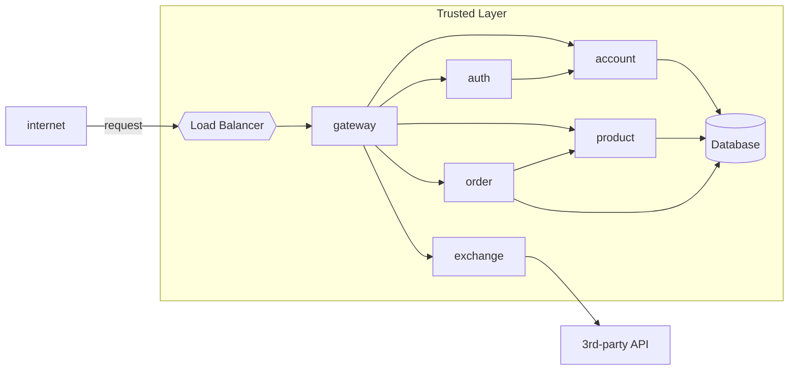

# Home

The **Microserv52 Platform** is a web application for buying and selling products.
It is a group project for the [Platforms, Microservices, DevOps and APIs
course](https://insper.github.io/platform/2026.2/exercises/project/).

## Documentation map

| Start here | What you will find |
| --- | --- |
| [Project](project.md) | Scope, architecture, requirements and delivery checklist |
| [Organization](organization.md) | Repository model, ownership and contribution workflow |
| [Get started](get_started.md) | Prerequisites and how to run the repository |
| [Developing](developing.md) | Repository layout, submodules and development workflow |
| [Rules](rules.md) | API, domain, security and reliability rules |
| [Testing](testing.md) | Layered verification strategy |
| [Delivery](delivery.md) | Final evidence and AI disclosure checklist |
| [Deployment](deployment.md) | Container and GitHub Pages deployment |
| [Operations](observability.md) | Logs, metrics, traces, health and alerts |
| [Performance](bottlenecks.md) | Bottleneck investigation and evidence |
| [Cloud](aws.md) | AWS account and resource setup |
| [Kubernetes](eks.md) | EKS topology and workload requirements |
| [CI/CD](cicd.md) | Build, image and deployment pipeline |
| [Load testing](load-testing.md) | Scenarios, metrics and autoscaling experiments |
| [Costs and SLA](costs.md) | Cost plan, PaaS choices and service objectives |
| [Service contracts](services/contracts.md) | Cross-service rules and integration points |

## Services

The platform is split into independently deployable services:

- [Product API](services/product/index.md): product catalogue and prices.
- [Order API](services/order/index.md): authenticated orders and totals.
- [Exchange API](services/exchange/index.md): currency conversion backed by a third-party provider.
- Gateway, Auth and Account are required platform services. Their contracts and
  integration responsibilities are documented in [Project](project.md); their
  implementation is not present in this repository snapshot.

