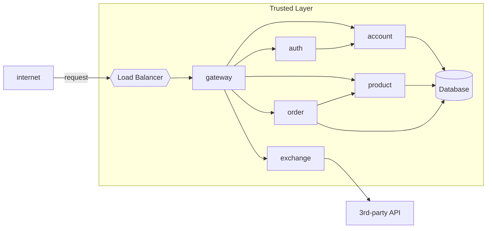

# Home

The **Microserv52 Platform** is a web application for buying and selling products.
It is a group project for the [Platforms, Microservices, DevOps and APIs
course](https://insper.github.io/platform/2026.2/exercises/project/).

## Documentation map

| Start here | What you will find |
| --- | --- |
| [Project](project/project.md) | Scope, architecture, requirements and delivery checklist |
| [Architecture](project/architecture.md) | Complete repository, runtime and deployment architecture |
| [Frontends](frontend/overview.md) | Landing, mock store and admin; one-domain routing, packages, PWA, Faro, Umami and local Docker testing |
| [Organization](project/organization.md) | Repository model, ownership and contribution workflow |
| [Get started](development/get_started.md) | Prerequisites and how to run the repository |
| [Developing](development/developing.md) | Repository layout, submodules and development workflow |
| [Rules](project/rules.md) | API, domain, security and reliability rules |
| [Testing](development/testing.md) | Layered verification strategy |
| [Delivery](project/delivery.md) | Final evidence and AI disclosure checklist |
| [Deployment](infrastructure/deployment.md) | Container and GitHub Pages deployment |
| [Operations](operations/observability.md) | Logs, metrics, traces, health and alerts |
| [Performance](operations/bottlenecks.md) | Bottleneck investigation and evidence |
| [Cloud](infrastructure/aws.md) | AWS account and resource setup |
| [Kubernetes](infrastructure/eks.md) | EKS topology and workload requirements |
| [CI/CD](development/cicd.md) | Build, image and deployment pipeline |
| [Load testing](operations/load-testing.md) | Scenarios, metrics and autoscaling experiments |
| [Costs and SLA](infrastructure/costs.md) | Cost plan, PaaS choices and service objectives |
| [Service contracts](services/contracts.md) | Cross-service rules and integration points |

## Services

The platform is split into independently deployable services:

- [Product API](services/product/index.md): product catalogue and prices.
- [Order API](services/order/index.md): authenticated orders and totals.
- [Exchange API](services/exchange/index.md): currency conversion backed by a third-party provider.
- [Gateway](services/gateway/index.md), [Auth](services/auth/index.md) and
  [Account](services/account/index.md) are present as API submodules.

## Web experience

The [frontend documentation](frontend/overview.md) describes three English-language
applications on one domain: landing at `/`, store at `/store`, and restricted
management at `/admin`. The store is an educational simulation: **no real
payments or transactions, and no shipment**. Public browsing and authenticated
demo order creation are implemented with Gateway/Account access changes.
The separate Docker fixture mode supports local UI testing; real Product/Exchange
integration and production CDN deployment still require acceptance.

