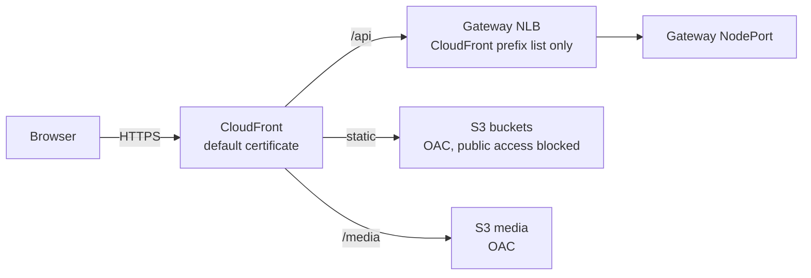

# AWS edge security

The platform uses AWS-native controls for the public edge. No third-party edge
proxy is part of the architecture.

## Current public edge

| Control | Current state |
| --- | --- |
| DDoS | AWS Shield Standard is automatic for CloudFront and the NLB |
| TLS | CloudFront default certificate; no custom domain or ACM certificate |
| Origin isolation | Gateway NLB security group allows only `com.amazonaws.global.cloudfront.origin-facing` |
| Static origins | S3 public access blocked; CloudFront OAC reads the buckets |
| API TLS | Viewer HTTPS to CloudFront; CloudFront to NLB is HTTP inside AWS |
| WAF | **Not enabled**; CloudFront has no web ACL yet |
| Edge logs | **Not enabled**; CloudFront standard logs and WAF logs are not configured |
| Grafana exposure | ClusterIP only; ALB + Cognito is documented but not applied |
| Secrets | Kubernetes Secret or Secrets Manager; no long-lived keys in Git |

## What to enable next

### AWS WAF

Attach a web ACL to the CloudFront distribution:

- AWS managed rule groups for common threats and known bad inputs;
- a rate-based rule for `/api/auth/login`, `/api/session/*` and write routes;
- body-size and method constraints for upload and API paths;
- logging to CloudWatch Logs or S3 with a retention budget;
- count mode first, then block after reviewing legitimate traffic.

WAF adds a monthly web ACL charge plus request charges. It is not enabled by
this repository.

### CloudFront and WAF logs

1. Enable CloudFront standard logs to a private S3 bucket.
2. Enable WAF logging to CloudWatch Logs or S3.
3. Query with Athena, or export selected fields to Loki only after a redaction
   review.
4. Keep cookies, authorization headers and signed upload query strings out of
   exported records.

Edge logs use CloudFront, AWS WAF and CloudWatch/S3; no third-party log pipeline is used.

### Grafana access

Grafana stays `ClusterIP`. When it is published, use an internet-facing ALB with
AWS WAF, an ACM certificate and Amazon Cognito authentication. Without a custom
domain there is no stable TLS hostname for the ALB, so the current supported
access path is `kubectl port-forward` or an SSM session. See
[Grafana on AWS](../operations/grafana-aws.md) and
[custom domains](custom-domains.md).

### Network controls

- Keep RDS and ElastiCache in private subnets with no public endpoint.
- Keep the Gateway NLB restricted to the CloudFront origin-facing prefix list.
- Add Kubernetes NetworkPolicies for observability scrape traffic.
- Use IAM/IRSA for S3, EBS CSI and any future WAF log delivery.
- Do not expose Prometheus, Loki, Tempo, Pyroscope, Mimir, Alloy or Grafana with
  a public `LoadBalancer` Service.

## Verification checklist

- [ ] Direct NLB access times out.
- [ ] S3 buckets reject public access.
- [ ] CloudFront serves `/`, `/store/`, `/admin/`, `/api/products` and
      `/api/actuator/health`.
- [ ] WAF is in count mode, then block mode, with reviewed logs.
- [ ] Grafana is unreachable without Cognito or port-forward.
- [ ] No third-party edge proxy resources, tokens or DNS records are required.
