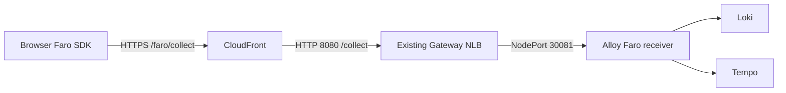

# AWS observability assessment

Account `730335608828`, region `us-east-1`. This page lists the observed AWS
state and the observability options that reuse the existing edge.

## Current AWS state

| Item | Observed state |
| --- | --- |
| CloudFront | `E2HCWED02TM6CL`; aliases: none; default CloudFront certificate |
| CloudFront origins | `s3-landing`, `s3-store`, `s3-admin`, `s3-media`, `api-gateway` (NLB, HTTP 80) |
| CloudFront behaviours | `/store/*`, `/admin/*`, `/media/*`, `/api/*`; default landing |
| Gateway NLB | `platform-gateway`; listener **80 only**; CloudFront prefix list only |
| AWS WAF | **No web ACLs** attached; an optional CloudFront web ACL is prepared behind `enable_waf = false` |
| ACM | **No certificates** |
| Route 53 | **No hosted zones** |
| EKS | `platform`; two `t3.medium` nodes; no `observability` namespace |
| App deployments | gateway, auth, account, order, product, exchange: `2/2` |
| Node memory | ~76% and ~60% used at idle |
| AWS observability | Not deployed; Terraform and manifests are prepared |
| Budget | Budget named `Limit budget 100`, configured limit **USD 150**; actual `$0.00` (billing delay), forecast `$0.07` |

The current edge already has AWS Shield Standard, CloudFront OAC, a
CloudFront-only NLB security group and private S3 buckets. It has no WAF, ACM
certificate or custom domain.

## Can we use Faro?

**Yes.** The existing NLB and CloudFront distribution are enough; no new load
balancer is required.

### Prepared path

- Add a second NLB listener on **8080** to a target group for Alloy NodePort
  **30081**.
- Add NLB security-group ingress on 8080 from the CloudFront origin-facing
  prefix list.
- Add a CloudFront origin on the same NLB with HTTP port **8080** and a
  `/faro/*` cache behavior with caching disabled.
- Extend the CloudFront function to strip `/faro`; `/faro/collect` becomes
  `/collect`.
- Set `NEXT_PUBLIC_FARO_URL=https://d15ogksm4jp6sl.cloudfront.net/faro/collect`.

This is prepared in Terraform behind `enable_faro_ingest = false`, in the
Kubernetes Alloy NodePort Service, and in the local nginx `/faro/` route. It is
not deployed. A default `terraform plan` with both feature flags false shows
only the CloudFront function update (the new `/faro` rewrite branch), with no
resources added or destroyed. Locally, nginx `/faro/collect` forwards to Alloy;
Playwright observed two browser POSTs returning 202.

### Why this option

| Option | Public origin | New load balancer | Relative cost | Verdict |
| --- | --- | --- | --- | --- |
| Reuse NLB port 8080 + CloudFront `/faro/*` | CloudFront | No | CloudFront requests + NLB LCUs | **Chosen** |
| Separate NLB for Alloy | CloudFront or direct | Yes | ≈ +$20/month base | Avoid |
| ALB + WAF for Alloy | ALB | Yes | ≈ +$20/month + WAF | More control, more cost |
| API Gateway + VPC Link | API Gateway | No NLB change | API + VPC Link charges | More moving parts |
| CloudFront VPC origin to internal NLB | CloudFront | Yes (internal) | NLB base + VPC origin | Strong isolation, unnecessary here |

CloudFront's default certificate is sufficient because the viewer hostname is
still the CloudFront hostname. No ACM certificate or custom domain is required
for this path.

## WAF investigation

No WAF web ACL is attached today. For a CloudFront web ACL, current AWS WAF
list pricing is:

| Component | Price |
| --- | ---: |
| Web ACL | $5.00/month |
| Custom rule or rule group | $1.00/month |
| AWS managed rule group | $1.00/month |
| Requests (up to 1500 WCU, 16 KB body) | $0.60 per million |
| Extra WCU above 1500 | +$0.20 per million per 500 WCU |
| CAPTCHA | $0.40 per 1,000 attempts |

### Example monthly costs

The prepared web ACL has 3 AWS managed rule groups + 1 rate-based rule
(4 billable rules/groups):

| Requests/month | Web ACL + rules | Requests | Total |
| ---: | ---: | ---: | ---: |
| 100,000 | $9.00 | $0.06 | **$9.06** |
| 1,000,000 | $9.00 | $0.60 | **$9.60** |
| 10,000,000 | $9.00 | $6.00 | **$15.00** |
| 100,000,000 | $9.00 | $60.00 | **$69.00** |
| 300 req/s continuous (≈778M) | $9.00 | ≈$467 | **≈$476** |

The demo's normal traffic is far below 1M requests/month, so a baseline WAF is
about **$10–11/month**. The cost becomes material only during sustained load
tests. CloudWatch Logs ingestion is extra.

The repository now prepares exactly that shape behind `enable_waf = false`:
AWS Managed Rules Common, Known Bad Inputs and IP Reputation, plus a
2,000-request/5-minute IP rate limit scoped to `/api/`. Bot Control and Fraud
Control are not enabled; they add separate costs.

## Cost summary

| Scenario | Approximate monthly |
| --- | ---: |
| Current application baseline (2 nodes) | ≈ $240 |
| Full self-hosted observability (+70 GiB, third node) | ≈ $280 |
| Faro through existing NLB/CloudFront (demo traffic) | < $5 incremental |
| WAF baseline at 1M requests | ≈ $10.60 |
| WAF baseline at 10M requests | ≈ $16 |
| ALB + Cognito for Grafana | ≈ +$20 |

The configured budget limit is **$150**, not the $100 implied by the budget
name. Actual spend reads $0.00 because Cost Explorer/Budgets ingestion is
delayed; the forecast is also near zero at the time of this check.

## Recommendation

1. Apply the observability Terraform/manifests first, confirming the third node
   and PVCs.
2. Enable the prepared Faro path and test with the local same-origin
   `/faro/collect` route before switching production frontend builds.
3. Enable the prepared WAF, review sampled requests, then keep block mode and add
   logging with a retention budget.
4. Reserve custom domain/ACM/Cognito work for a separate authorization.
5. Keep the stack scheduled or destroyed after the demo; the run-rate exceeds
   the budget if left running continuously.

## Related

- [AWS edge security](aws-edge-security.md)
- [Grafana on AWS](../operations/grafana-aws.md)
- [Costs, PaaS and SLA](costs.md)
- [Custom domains](custom-domains.md)
