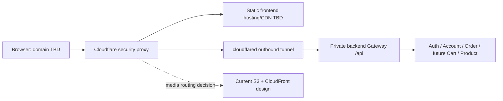

# Cloudflare security edge

## Selected purpose and open decisions

Cloudflare is selected for **DDoS protection, WAF and origin connectivity through
Tunnel**, with additional security controls evaluated for the chosen plan.
Nothing has been provisioned. **The frontend CDN provider and domain name remain
open decisions.** Selecting Cloudflare security does not select Cloudflare
Pages/Workers, R2, frontend hosting or a replacement for the approved S3 image
storage design. CloudFront image delivery remains the current design baseline;
any CDN migration requires a separate decision.

The selected security capabilities are described in Cloudflare's official
[DDoS](https://developers.cloudflare.com/ddos-protection/),
[WAF](https://developers.cloudflare.com/waf/) and
[Tunnel](https://developers.cloudflare.com/cloudflare-one/networks/connectors/cloudflare-tunnel/)
documentation. Rules, quotas, rate limiting, bot controls, logging and export
entitlements depend on the chosen product/plan; no paid subscription or feature
availability is assumed.

## Target boundary

Tunnel uses an origin-side `cloudflared` connector to establish outbound
connections. It does not make an application's authorization correct by itself.
The target backend must deny direct Internet bypass of the protected path,
and the connector should reach the internal Gateway rather than exposing Redis,
Kafka, PostgreSQL, Actuator details or internal service endpoints.

Choose the actual route and connector placement when backend hosting is ready.
A generic static CDN cannot run `cloudflared`; its frontend origin uses the
hosting provider's supported proxy/origin configuration. Confirm provider TLS,
custom-domain and multi-CDN restrictions before selecting the frontend host.
Tunnel is intended for backend origin connectivity, not as an implicit design
for serving S3 images or presigned browser uploads.

## Policies to implement and verify

| Area               | Planned behavior                                                                                                                                                                                      |
| ------------------ | ----------------------------------------------------------------------------------------------------------------------------------------------------------------------------------------------------- |
| DDoS and WAF       | Enable applicable managed protections, tune rules with logs, and test legitimate API/form flows before enforcing custom blocks.                                                                       |
| Abuse controls     | Evaluate rate limits for login, registration, cart writes, demo orders and media ticket creation; supplement per-IP edge limits with authenticated application limits.                                |
| Session boundary   | Retain API authorization, roles, CSRF and Secure/HttpOnly cookies. Edge security does not replace them. Trust forwarding/client-IP headers only from the configured edge path.                        |
| Private data       | Explicitly bypass caching for cart, session, account, order, admin and write routes; preserve `Cache-Control: no-store` and cookie behavior.                                                          |
| Static/media cache | CDN choice stays open; decide immutable asset/media TTLs separately from security proxying and private API policy.                                                                                    |
| Tunnel/origin      | Store connector credentials as backend secrets, restrict reachability, rotate credentials and plan redundant connectors/health checks and a tested rollback.                                          |
| Diagnostics/admin  | Evaluate Cloudflare Access as an additional gate for internal tools/admin. It does not replace ROLE_ADMIN checks. Apply API-compatible policies rather than HTML challenges that break fetch clients. |
| Observability      | Correlate edge request identifiers with backend traces where safe; decide log export availability and ingestion into Grafana Cloud without personal-data leakage.                                     |

Cloudflare [cache rules](https://developers.cloudflare.com/cache/how-to/cache-rules/settings/)
support separate cache eligibility decisions. Initially, API caching should be
bypassed while the edge and CDN layout is verified. If the selected CDN supports
public catalog caching later, add a reviewed exception with explicit invalidation
and no personalized response sharing. Do not enable blanket “cache everything.”

Browser Faro ingestion and Umami script/ingestion routes need a tested policy so
telemetry is neither broken by challenges nor broadly exempted from protections.
Presigned S3 uploads remain limited to approved origins and should not be routed
through Tunnel or have their signed host/path/headers rewritten by the edge.

Before deployment, decide the domain/DNS setup, Cloudflare plan, zone and API
permissions, origin hostnames/TLS, connectors, WAF/rate-limit rules, access
policies, log export, caching exceptions and incident ownership. No domain is
registered, DNS changed, tunnel created, or CDN migration authorized by this
architecture update.
