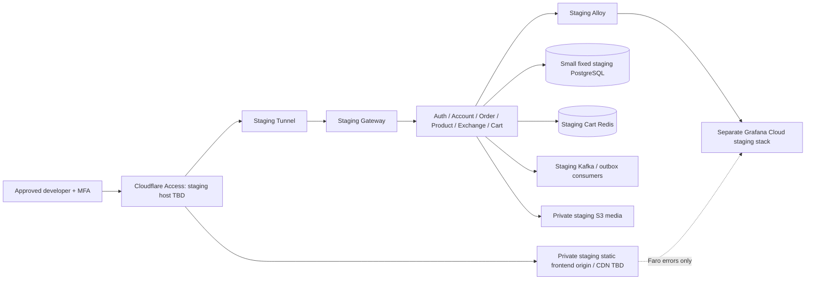

# Staging environment — TODO, planning only

**Status: NOT IMPLEMENTED.** This page is the staging design and implementation
backlog. It creates no infrastructure, application configuration, secrets,
scheduler or deployment workflow. Merging the documentation does not authorize
provisioning. The owner confirmed **scheduled availability** and **synthetic demo
seed data**. Exact operating hours/timezone, budget, region and resource classes
remain open. The domain and frontend CDN provider remain undecided.

Tracking: [implementation TODO #13](https://github.com/Microsserv52/platform/issues/13).
Keep it open until implementation is separately authorized and verified.

## Requirements and parity boundary

Staging must run the same application services, API contracts, engine/protocol
versions, schema migrations and security boundaries as production, at smaller
fixed capacity. It is developer-only behind Cloudflare Zero Trust Access, with
separate resources, credentials and observability. Umami and all product-usage
analytics are disabled. **Faro remains enabled for technical error reporting.**

One replica, one availability zone and fixed-size data services intentionally
reduce availability and throughput. Staging validates functionality and release
compatibility; it cannot prove production HA, quorum, autoscaling or capacity.
There is no automatic horizontal, vertical, node or database storage scaling in
the proposed baseline. Budget alerts request manual action rather than silently
increasing resources.

The missing Product/Exchange implementations and future Cart/Kafka work are
dependencies. Staging cannot be called complete while production services are
replaced with the frontend HTTP fixture. Bring the same real service versions
into both environments as those services are delivered.

## Proposed low-cost topology; hosting approval still needed

Use a **dedicated staging environment**, preferably in a separate AWS account,
otherwise in an isolated VPC/cluster with strict IAM and network boundaries.
Do not place staging in the production database, Redis, Kafka broker or cluster
just to reduce the bill. A namespace and an environment label alone are not the
required data/security separation.

| Option                                                        | Fit                                                                                                                                                         | Tradeoff / decision                                                                                                                                                                      |
| ------------------------------------------------------------- | ----------------------------------------------------------------------------------------------------------------------------------------------------------- | ---------------------------------------------------------------------------------------------------------------------------------------------------------------------------------------- |
| One fixed EC2 VM with the already-documented MicroK8s runtime | Proposed cost-first baseline: Kubernetes application manifests, one replica per service, no managed control-plane fee; stop the VM outside working windows. | Self-managed node/control plane and a single failure domain. It does not test EKS-specific behavior; approve this parity exception and validate EKS-specific release changes separately. |
| Dedicated small EKS cluster with a fixed node group           | Choose when managed EKS/control-plane parity is required.                                                                                                   | Recurring cluster fee plus workers, networking and storage. Stopping workers does not remove the cluster fee; obtain a separate estimate before choosing.                                |

Production remains targeted at EKS. Final staging hosting is **not selected by
this plan**. A starting fit exercise for the VM option is approximately 4 vCPU
and 8–16 GiB RAM, choosing the smallest fixed size that actually boots every
service with headroom. Seven API services plus Kafka and collection agents must
be measured together; a tiny VM is not assumed to fit multiple JVMs. Prefer the
existing image architecture until multi-architecture images are verified.

[AWS EKS pricing](https://aws.amazon.com/eks/pricing/) separates the cluster fee
from worker resources. Compare total cost, including operations and mandatory
private-network egress, rather than only VM price. Prefer private application
subnets and restricted outbound access. NAT, endpoints and any alternative
egress design require their own estimate/security review; do not silently make
the origin public to avoid those costs.

## Component coverage and starting sizing envelope

These are planning targets, not tested resource limits or an approved bill.
Choose exact classes after a cold-start/steady-state fit test and budget review.

| Component                                              | Staging plan                                                                                                                                                                                  | Parity and isolation                                                                                                                                                                             |
| ------------------------------------------------------ | --------------------------------------------------------------------------------------------------------------------------------------------------------------------------------------------- | ------------------------------------------------------------------------------------------------------------------------------------------------------------------------------------------------ |
| Landing, Store, Admin                                  | Three static exports, each built with staging-only public values; isolated origin/artifacts, no Next.js server.                                                                               | Same source commit and routes as the release candidate; keep frontends outside Kubernetes. Hosting/CDN must support developer-only access with no public preview-origin bypass.                  |
| Gateway, Auth, Account, Order, Product, Exchange, Cart | One fixed instance/pod of each deployed service. Initial per-JVM planning range: 100–250m CPU request, 256 MiB request, 512–768 MiB memory limit, then measure and tune heap/native overhead. | Same images, versions, contracts, auth, CSRF, migrations and features. Keep services separate; the reusable Order contract is a library, not an extra running service.                           |
| PostgreSQL                                             | One separate small provisioned Single-AZ instance, same production engine major/extensions; evaluate a 1–2 GiB class first, fixed storage at the supported minimum plus measured headroom.    | No serverless scaling, storage autoscaling, read replicas or Multi-AZ in this baseline. Restrict connections and use small per-service pools; pool totals must fit the DB. Synthetic seed only.  |
| Redis Cart                                             | One separate fixed instance/process with persistence/volume policy and bounded memory; a 128–256 MiB **data** budget is a starting estimate, not total process RAM.                           | Same protocol/data model and seven-day write-based cart TTL. Dedicated cart memory/eviction policy; do not share production or disposable cache resources. No automatic failover capacity claim. |
| Kafka and implemented relay/consumers                  | One small staging broker/controller and one consumer replica per implemented group; fixed disk/retention/partition limits.                                                                    | Same Kafka version and event schemas. Single-node KRaft is a development compromise, not production quorum validation. Stage-only replication/ISR/internal-topic settings must match one broker. |
| Product media                                          | Separate private S3 bucket and IAM policy; small synthetic image dataset and explicit lifecycle.                                                                                              | Same upload/validation flow. Staging media delivery is private behind Access; no public bucket or unprotected CDN-origin URL. CDN migration remains open.                                        |
| Exchange provider / other external dependencies        | Real Exchange service with separate sandbox/read-only test credentials or a documented deterministic provider behind its adapter.                                                             | Never replace a business service with the frontend fixture or share production provider credentials. External limitations must be visible in release evidence.                                   |
| Cloudflare                                             | Separate staging Access application, Tunnel credentials, policies and connector configuration.                                                                                                | Whole-host protection and no direct origin ingress; same WAF/application authorization principles.                                                                                               |
| Grafana Cloud / Alloy / Faro                           | Separate staging stack/collector credentials; one small Alloy collector and the same signal integrations, with lower approved ingestion budgets.                                              | Production telemetry, dashboards and alerts must not ingest staging data. Faro errors enabled.                                                                                                   |
| Umami / usage analytics                                | No staging tracker, pageviews, demo funnel events or analytics ingestion; no staging Umami deployment required.                                                                               | Intentional exception to service parity, explicitly requested by the owner. Technical error/health telemetry remains active.                                                                     |

Do not apply production overlays unchanged. Current `k8s/70-hpa.yaml` starts
services at three replicas and `71-pdb.yaml` requires two available replicas.
The future staging overlay must omit HPA, set one replica, and use a compatible
disruption/rollout policy so maintenance is not blocked. Fix node count and
database storage/compute size as well; removing HPA alone is insufficient.
Keep resource/probe/security settings and budget for rollout surge, or document
an intentional short maintenance outage. This page does **not** edit manifests.

For Kafka, see the official [KRaft deployment guidance](https://kafka.apache.org/41/operations/kraft/).
Retention must cover the maximum planned shutdown plus the required replay
window within a fixed disk budget. One broker cannot demonstrate replication,
controller quorum or production fault tolerance. The outbox/consumer behavior
must still be real and tested for retries, duplicates and recovery.

## Developer-only access

1. Protect the entire staging hostname and all paths with Cloudflare Access,
   including `/`, `/store/`, `/admin/`, `/api/*`, media and diagnostics. Require
   an explicit developer identity-provider group with MFA; default deny. Use
   limited session duration and remove access when group membership changes.
2. Use a separate `cloudflared` connector and staging-only origin mapping. Keep
   backend, database, Redis and Kafka off direct Internet ingress. Protect the
   Kubernetes control plane and administration path with approved private access.
3. Preserve application login, roles and CSRF after Access succeeds. A developer
   may test an ordinary demo account; Access must not silently grant ROLE_ADMIN.
4. Restrict static hosting preview URLs, bucket URLs and media origin bypasses.
   An obscure URL, `robots.txt` or `noindex` is not authorization. No staging
   release is accepted until every content origin has an enforceable private path.
   Presigned upload capabilities, if used, must be short-lived, staging-bucket-only
   and issued after Access plus application authorization; uploaded objects and
   media reads remain private. Never expose production signing credentials.
5. If CI must reach staging, use a separately approved, narrowly scoped Access
   service identity. Store credentials only in CI secrets, rotate them, and send
   headers only to the staging origin—not to Faro, S3 or other third parties.
   Public PR builds must not receive staging credentials.

Cloudflare documents [Access applications](https://developers.cloudflare.com/cloudflare-one/access-controls/applications/http-apps/)
and [machine service tokens](https://developers.cloudflare.com/cloudflare-one/access-controls/service-credentials/service-tokens/).
Select the plan/IdP/policies later; no application, identity group or token has
been created. Do not broadly bypass Access to make tests or telemetry work.

## Separate observability, Faro on, analytics off

Use a **separate Grafana Cloud staging stack**, with separate ingestion scopes,
Faro application/collector values, dashboards, alert routing and access roles.
An `environment=staging` label remains useful but is not isolation by itself.
[Multiple stacks depend on the Grafana Cloud plan](https://grafana.com/docs/grafana-cloud/platform/security-and-account-management/account-management/cloud-stacks/create-update-stacks/);
if the chosen plan cannot provide the required isolation, resolve account/plan
and cost before deployment instead of mixing staging into production.

Keep Prometheus/Mimir, Loki, Tempo, Pyroscope, OTel/Alloy and Graphite support
consistent with implemented production signals. Limit sampling/retention to
the approved staging budget; do not invent a Graphite producer or disable all
diagnostics just to reduce ingestion. Expected schedule downtime must suppress
staging availability alerts, but failed start/stop jobs and budget/secret alerts
remain monitored externally. Staging alerts go to developers, not production
on-call routes. Disable usage/funnel exporters and Kafka analytics consumers too; operational
read models and error/health metrics are not product analytics. No real alert
messages are sent as part of this plan.

**Required frontend TODO:** the three current `Telemetry` components use
`NEXT_PUBLIC_ENABLE_TELEMETRY` to gate both Faro and Umami, and manual Umami
tracking is not independently environment-gated. Separate the controls before
staging is accepted. Proposed future build contract:

| Setting                         | Required staging behavior                                                                                             | Implementation status                                                            |
| ------------------------------- | --------------------------------------------------------------------------------------------------------------------- | -------------------------------------------------------------------------------- |
| `NEXT_PUBLIC_APP_ENV`           | `staging` with the release version                                                                                    | Existing setting; staging build/config still TODO.                               |
| `NEXT_PUBLIC_ENABLE_FARO`       | `true`, pointing only at the staging collector                                                                        | Proposed new independent control; not implemented.                               |
| `NEXT_PUBLIC_ENABLE_ANALYTICS`  | `false`, regardless of accidentally supplied Umami configuration                                                      | Proposed new independent control; not implemented.                               |
| Umami script/site configuration | Unset, with both script injection and every manual tracking call blocked                                              | Required code/build/test work; blank configuration alone is insufficient.        |
| Faro payloads                   | Technical errors and approved diagnostic signals only; no product-usage events, replay, sensitive URLs or credentials | Preserve existing sanitization/opt-out/DNT policy; add staging acceptance tests. |

Do not treat `NEXT_PUBLIC_ENABLE_TELEMETRY=false` as the staging solution: that
also disables Faro. Introduce independent code gates in all three frontend
repositories, update Docker build arguments/environment examples and privacy
copy, and plan the legacy flag migration without accidentally enabling
production collection. This is a future task, not a configuration change made
by this document. Frontend environment values are public, never secret tokens.

## Data, secrets and deployment boundaries

- Use versioned, repeatable **synthetic demo seeds** with fake accounts, products,
  images and demo orders. Never copy unsanitized production records, sessions,
  tokens, Redis carts, Kafka events or telemetry. Reset is an explicit developer
  operation with environment checks and no production credentials available.
  Inject generated staging-only seed credentials through the secret store; do
  not publish fixed admin passwords or add public role-promotion behavior.
- Use the same migration chain and database extensions as production. A small
  independent database copy means schema/engine parity, not a production data
  clone or a replication connection.
- Isolate DB users, Redis credentials, broker ACLs/topics, S3 buckets/keys,
  encryption/IAM roles, Tunnel tokens, JWT/service secrets and telemetry tokens.
  Prefer short-lived CI cloud credentials and least-privilege staging roles;
  staging must have no production write access.
- Plan a protected GitHub `staging` environment with its own approvals/secrets,
  concurrency and explicit deployment target. The existing manual EKS workflow
  targets `production` and must not be reused without a separate reviewed design.
- Promote immutable backend image digests. Frontends use the same tested source
  commits but need separate builds because public environment values are baked
  into static exports. Keep staging/prod artifacts and browser cookies isolated;
  no cookie `Domain` shared across environment hosts.
- Give staging S3/Redis/Kafka volumes and DB backups fixed quotas/lifecycle and
  a reset/restore procedure. Synthetic data reduces recovery requirements but
  does not remove the need to test migrations and restores before promotion.

## Scheduled operation and cost control

The owner selected scheduled availability. **Hours, days, schedule timezone,
startup lead time, maximum manual extension and monthly cap are TBD.** Store
timestamps in UTC and use a configurable IANA timezone for the schedule; do not
hardcode a developer's local timezone in scripts.

Future start/stop automation must run outside the environment it shuts down.
Start database/stateful dependencies before applications, wait for migrations,
health and service parity checks, then mark staging ready. Keep a protected
maintenance response until ready. Stop new writes, drain bounded in-flight
work, checkpoint/flush stateful services, stop applications/broker/Redis and
then stop compute/database safely. Kafka/outbox state survives according to
the chosen volume/retention policy. A manual extension must expire automatically.

Stopped compute does not mean zero cost: storage, snapshots, addresses/egress
resources, observability, static hosting, security plans and some managed
services can still be billed. RDS can automatically restart after seven stopped
days and startup can take time; its external schedule must detect/reconcile that
behavior. See [RDS stop/start constraints](https://docs.aws.amazon.com/AmazonRDS/latest/UserGuide/USER_StopInstance.html).
Redis cart TTL follows elapsed time, including downtime; do not pause the agreed
seven-day cart expiry when staging sleeps.

Estimate cost with operating hours, not an assumed 24/7 month, while pricing
persistent resources for the full billing period. Include compute, DB/storage,
backups, Redis/Kafka disk, network egress/NAT/endpoints, S3 requests, private
frontend hosting, Cloudflare and separate Grafana Cloud ingestion. Choose the
exact region/classes and dated price estimate through the
[AWS Pricing Calculator](https://calculator.aws/) before authorizing resources.
No free tier, subscription entitlement or monetary total is assumed here.

## Implementation backlog — all TODO

- [ ] **Owner + Platform:** approve monthly cap, schedule/timezone, region and
      cost-first MicroK8s versus dedicated EKS; record the accepted parity exceptions.
- [ ] **Platform:** inventory production services and lock staging engine/image
      versions, resource limits, single-replica overlays, HPA/PDB behavior and private egress.
- [ ] **Security:** choose IdP/developer group/MFA, Access policies, protected
      origins, Tunnel/admin paths and optional CI identity; test direct-origin denial.
- [ ] **Data:** create separate fixed-size DB, cart Redis, broker/volumes and S3
      resources with quotas, secrets, restore/reset and lifecycle policies.
- [ ] **Service owners:** supply real Product/Exchange/Cart services and the
      implemented Kafka/outbox/consumer components; block readiness on missing services.
- [ ] **Service owners:** create repeatable synthetic seeds and migration/contract
      tests; prevent staging credentials or data paths from reaching production.
- [ ] **Frontend owners:** implement independent Faro/analytics controls in all
      three repositories and update build arguments, examples, privacy copy and tests.
- [ ] **Observability:** provision the separate staging Grafana Cloud stack and
      Faro collector; set scopes, retention/sampling, dashboards and developer alerts.
- [ ] **Delivery:** design staging-only CI environments, immutable artifact/source
      promotion, approvals, rollback and test identities; obtain dependency approvals.
- [ ] **Operations:** implement external start/stop scheduling, readiness gates,
      downtime-aware alerts, expiring extensions and stop-failure/budget monitoring.
- [ ] **QA:** verify approved-developer access, denied outsiders, app-role/CSRF
      enforcement, all-service flows and environment isolation.
- [ ] **QA:** trigger a sanitized browser error and verify it reaches only staging
      Faro; verify **zero Umami scripts, requests, pageviews or demo analytics events**
      even if analytics URLs are accidentally supplied. Test offline/collector failure.
- [ ] **QA + Platform:** verify restart/recovery, cart expiry through downtime,
      outbox replay and no unexpected scale-up; measure simultaneous startup fit/cost.
- [ ] **Release owner:** accept limitations and require a separate production-like
      exercise for EKS-specific, HA/quorum, HPA and real capacity changes before promotion.

The plan stays TODO until these tasks have implementation/evidence. Staging is
not a production capacity test, and all environments keep the mock-store
notice: no real payments, transactions or shipments.
