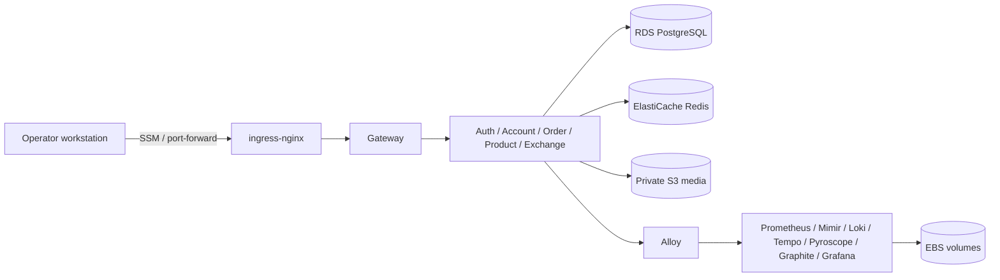

# Staging environment

Staging is a separate AWS deployment for developer acceptance of the same
service versions and contracts used in production. It has its own VPC, EKS
cluster, RDS instance, ElastiCache cluster, S3 buckets, ECR repositories and
observability stack.

The configuration lives in two places:

| Layer | Path | Contents |
| --- | --- | --- |
| Infrastructure | `terraform/environments/staging` | VPC, EKS node group, RDS, ElastiCache, S3, ECR and the EBS CSI add-on |
| Workloads | `k8s/overlays/staging` | One replica per service, fixed HPA bounds, staging ConfigMap and OpenTelemetry environment |

!!! note "Delivery status"

    The repository contains the staging configuration. No GitHub Actions
    workflow provisions or deploys staging. An operator runs Terraform and
    `kubectl` from an authenticated workstation. Nothing in this repository
    deploys the stack automatically.

## Topology



The VPC uses `10.30.0.0/16` and two availability zones. Worker nodes run in the
private subnets; the NAT gateway provides image-pull and AWS API egress. RDS and
ElastiCache are private and single-AZ.

There is no CloudFront distribution, WAF, Route 53 record or public load
balancer in the staging environment. The cluster is reached through the EKS
endpoint with IAM authentication and through `kubectl port-forward`. This keeps
the environment developer-only without a custom domain or certificate.

## Infrastructure defaults

The values are defined in `terraform/environments/staging/variables.tf` and can
be overridden through a `terraform.tfvars` file.

| Resource | Default | Notes |
| --- | --- | --- |
| Kubernetes | EKS `1.35` | Public endpoint with IAM authentication |
| Nodes | 1 × `t3.xlarge`, `SPOT` | Fixed at 1–1; no Cluster Autoscaler |
| Database | `db.t4g.micro`, 20 GB | Single-AZ, 1-day backups, deletion protection off |
| Cache | 1 × `cache.t4g.micro` | No replica or failover |
| Storage | media + landing/store/admin buckets | Private, versioned, lifecycle rules |
| Registry | six ECR repositories | `force_delete` for disposable rebuilds |
| Observability storage | EBS CSI add-on and IRSA role | Required by the observability PVCs |
| NAT | 1 gateway | Private node egress |
| Name prefix | `platform-staging` | Separates every resource from production |

The Terraform state uses the same S3 backend and native locking as production,
with a staging-specific key. State contains the generated database password;
keep the bucket private and encrypted.

## Workload differences

`k8s/overlays/staging` builds on `k8s/base` and changes only the staging
operating envelope:

| Setting | Production | Staging |
| --- | --- | --- |
| Service replicas | 2, HPA 2–6 | 1, HPA fixed at 1 |
| Pod disruption budget | `minAvailable: 1` | `maxUnavailable: 1` |
| OpenTelemetry environment | `deployment.environment=cluster` | `deployment.environment=staging` |
| Session cookie | `SESSION_COOKIE_SECURE=true` | `false` because access is HTTP port-forward |
| Product media origin | CloudFront domain | Removed; Product uses the private S3 bucket |
| Ingress exposure | CloudFront → NLB → NodePort | Cluster-internal; port-forward only |

The deployment keeps the production probes, security contexts, resource
requests and rolling-update strategy. The Exchange provider URL and API key are
supplied through the staging ConfigMap and Secret before rollout, as in
production. Services still read `platform-config` and `platform-secrets` from
the `platform` namespace, so the Product IRSA role matches the service account.

Frontends are static exports and are not Kubernetes workloads. The staging
Terraform creates their private S3 buckets, but no staging CDN or public web
origin exists. A staging frontend build runs locally against the forwarded
Gateway endpoint.

## Access

Prerequisites are an AWS identity with EKS access, the cluster name from the
Terraform output, and an ingress-nginx controller in the cluster.

```bash
aws eks update-kubeconfig --name platform-staging --region us-east-1
kubectl -n ingress-nginx port-forward svc/ingress-nginx-controller 8080:80
```

The Gateway is then available at `http://localhost:8080/api`. Direct pod access
is also possible through `kubectl port-forward svc/gateway 8080:8080`, but the
Ingress path preserves the `/api` prefix and the session cookie path.

The EKS endpoint is public but requires IAM authentication. Database, cache,
media bucket and observability endpoints have no public ingress.

## Data and secrets

- Use synthetic accounts, products, images and orders. Staging has no
  connection to production data stores, buckets, Secrets Manager entries or
  telemetry backends.
- Create `platform-secrets` in the staging cluster with
  `scripts/create-platform-secrets.sh` and staging-only values. The script
  targets the current kubectl context; verify the context before running it.
- Database credentials come from the Terraform output. Do not commit a
  `terraform.tfvars` file or a rendered Secret.
- The Product service account is annotated with the staging IRSA role so the
  pod reads and writes only the staging media bucket.
- The Exchange provider points at a sandbox or adapter endpoint supplied for
  staging; never use production provider credentials.

## Observability

Staging runs its own observability namespace and storage on the same cluster.
`enable_ebs_csi = true` provisions the CSI add-on and IRSA role; the manifests
in `k8s/observability` are applied after the cluster exists. Prometheus, Mimir,
Loki, Tempo, Pyroscope, Graphite, Alloy and Grafana use staging-only volumes and
credentials. Production dashboards and alerts do not ingest staging data.

Services export traces to the cluster Alloy endpoint through the OpenTelemetry
Java agent. The resource attribute is `deployment.environment=staging`, which
separates staging traces from production traces in Tempo.

There is no public Faro collector. The staging frontends are local builds, so
browser telemetry is not part of the staging cluster. Umami and product-usage
analytics are not deployed in staging.

## Cost

The estimate uses `us-east-1` list prices and the defaults above.

| Resource | Continuous (USD/month) |
| --- | ---: |
| EKS control plane | ≈ 73 |
| 1 × `t3.xlarge` SPOT node | ≈ 36 |
| NAT gateway and public IPv4 | ≈ 36 |
| RDS `db.t4g.micro` + 20 GB | ≈ 14 |
| ElastiCache `cache.t4g.micro` | ≈ 12 |
| EBS, S3, ECR and observability volumes | ≈ 10–20 |
| **Total** | **≈ 180–190** |

On-Demand capacity replaces the node line with ≈ 121, for ≈ 265/month.
Running compute for 10 hours × 5 days lowers the compute, cluster and NAT lines
to ≈ 60–90/month while storage and backups remain at full-month rates. The
[cost analysis](costs.md#staging-estimate) records the assumptions and the
scheduled-operation caveats. Staging has no free-tier guarantee.

## Manual operation

The stack is provisioned and updated by an operator, not by CI:

```bash
export AWS_PROFILE=platform
export TF_STATE_BUCKET=platform-tfstate-<account-id>

terraform -chdir=terraform/environments/staging init \
  -backend-config="bucket=$TF_STATE_BUCKET" \
  -backend-config="key=platform/staging.tfstate" \
  -backend-config="region=us-east-1"
terraform -chdir=terraform/environments/staging apply

aws eks update-kubeconfig --name platform-staging --region us-east-1
kubectl apply -k k8s/overlays/staging
```

Push the six service images to the staging ECR repositories before applying the
overlay, and point the Deployments at the immutable staging tags:

```bash
REGISTRY="$(terraform -chdir=terraform/environments/staging output -raw registry)"
for service in account auth exchange gateway order product; do
  kubectl -n platform set image "deployment/$service" \
    "$service=$REGISTRY/$service:<tag>"
done
```

Install ingress-nginx and the observability stack after the overlay. The
[deployment runbook](runbook.md) covers AWS authentication, image publishing and
the observability installer. Teardown is a normal `terraform destroy`; the
staging environment keeps no deletion protection.

## Limits

Staging validates functionality and release compatibility at low fixed
capacity. It does not prove production high availability, quorum, autoscaling
or database throughput: one node, one availability zone and single-instance
data services are intentional. Scheduled shutdown of compute does not stop
storage, backups or public IPv4 billing, and RDS and ElastiCache do not have a
stopped state that preserves the instance.

The staging overlay removes the public media origin because it has no
CloudFront distribution. Product stores image objects in the private staging
bucket, but the catalogue cannot render them until staging gains a media
distribution or presigned read URLs; the UI shows its unavailable-image
fallback.

## Related

- [Deployment](deployment.md)
- [Costs](costs.md)
- [AWS](aws.md)
- [EKS](eks.md)
- [Observability](../operations/observability.md)
