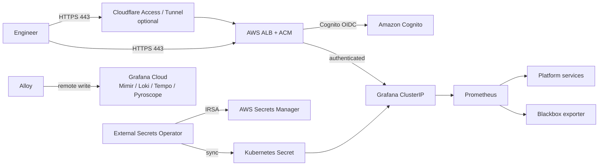

# Grafana on AWS

This page describes the prepared AWS deployment. It is **not applied**; the
live stack currently runs Prometheus and Grafana only in local Docker Compose.

## Topology



Grafana is never exposed with a `LoadBalancer` Service or a public ALB without
authentication. The ALB uses Cognito; Grafana sees only authenticated requests.
The alternative is Cloudflare Tunnel + Cloudflare Access, which avoids an ALB
and inbound ports at near-zero cost.

## What the repository provides

| Asset | Purpose |
| --- | --- |
| `observability/helm/values.yaml` | kube-prometheus-stack with Grafana/Alertmanager disabled |
| `k8s/observability/grafana.yaml` | Grafana Deployment, PVC and ClusterIP Service |
| `k8s/observability/blackbox.yaml` | In-cluster blackbox exporter |
| `k8s/observability/servicemonitors.yaml` | Scrapes all six services |
| `k8s/observability/probe.yaml` | External CloudFront synthetic checks |
| `k8s/observability/grafana-ingress-cognito.example.yaml` | ALB + Cognito ingress |
| `k8s/observability/external-secret.example.yaml` | Secrets Manager → Kubernetes |
| `scripts/install-observability.sh` | Creates ConfigMaps, PrometheusRule and Helm release |
| `terraform/environments/aws` | Optional EBS CSI, secret containers |
| `terraform/environments/grafana-cloud` | Cloud dashboards, alerts and synthetic checks |

## Prerequisites

1. **EBS CSI driver and a `gp3` StorageClass.** Terraform creates the IRSA role
   and add-on when `enable_observability = true`.
2. **AWS Load Balancer Controller** with IRSA. It is not installed by this
   repository; install it once per cluster.
3. **Cognito user pool, app client and domain** for the ALB authentication
   action. Restrict sign-up: admins create users.
4. **ACM certificate** in the ALB region and a DNS record for the Grafana host.
5. **External Secrets Operator** or an equivalent secret sync. The example uses
   a `ClusterSecretStore` named `aws-secrets-manager`.
6. **Kubernetes context** for the target EKS cluster.

> [!WARNING]
> Applying Terraform or Helm changes AWS resources. Get explicit owner
> authorization before running the commands below.

## Step 1 — Terraform preparation

Set the flag and apply:

```bash
export TF_VAR_enable_observability=true
export PATH="$HOME/.local/bin:$PATH"
terraform -chdir=terraform/environments/aws init
terraform -chdir=terraform/environments/aws apply
```

This adds:

- `aws-ebs-csi-driver` and its IRSA role;
- Secrets Manager containers `platform/grafana/admin` and
  `platform/grafana/alerting`.

It does **not** write secret values and does **not** deploy Grafana.

## Step 2 — Write secrets out of band

Use the prompt-based script; the password is not echoed and does not enter shell
history:

```bash
scripts/create-grafana-secrets.sh
```

It writes:

| Secret | Keys | Consumer |
| --- | --- | --- |
| `platform/grafana/admin` | `username`, `password` | `grafana-admin` Kubernetes Secret |
| `platform/grafana/alerting` | `email_to` | `grafana-alerting` Kubernetes Secret |

Do **not** put these values in `terraform.tfvars`, Helm values, Git, CI logs or
dashboards. Terraform only creates the containers.

### Option A — External Secrets Operator

Apply `k8s/observability/external-secret.example.yaml` after creating the
`aws-secrets-manager` ClusterSecretStore and an IRSA role that can read
`platform/grafana/*`.

### Option B — direct Kubernetes Secret for a first install

```bash
export GRAFANA_ADMIN_PASSWORD='read-from-a-password-manager'
kubectl -n observability create secret generic grafana-admin \
  --from-literal=admin-user=admin \
  --from-literal=admin-password="$GRAFANA_ADMIN_PASSWORD"
unset GRAFANA_ADMIN_PASSWORD
```

This is acceptable for a short-lived demo but not as a long-term process.

## Step 3 — Install the stack

```bash
scripts/install-observability.sh
```

The script:

1. Creates the `observability` namespace.
2. Creates or reuses `grafana-admin` and `grafana-alerting`.
3. Creates ConfigMaps from `observability/grafana/provisioning`,
   `observability/grafana/dashboards` and `observability/blackbox`. The
   cluster uses `observability/grafana/aws/datasources.prometheus.yml`; Grafana Cloud owns logs, traces
   and profiles, so no in-cluster Loki/Tempo/Pyroscope is required.
4. Converts the recording rules into a `PrometheusRule`.
5. Installs `kube-prometheus-stack` with Grafana and Alertmanager disabled.
6. Applies Grafana, blackbox, ServiceMonitors, Probe and NetworkPolicy.
7. Waits for Grafana and blackbox rollouts.

Access it through a port-forward first:

```bash
kubectl -n observability port-forward svc/grafana 3000:3000
open http://localhost:3000
```

## Step 4 — Publish behind an account

### Option A — ALB + Cognito (AWS-native)

Fill in the real domain, ACM ARN, user-pool ARN, client ID and Cognito domain in
`grafana-ingress-cognito.example.yaml`, rename it to `.yaml`, and apply it:

```bash
kubectl apply -f k8s/observability/grafana-ingress-cognito.yaml
```

The ALB:

- terminates TLS with ACM;
- redirects unauthenticated users to Cognito;
- allows only users in the configured pool;
- forwards authenticated traffic to the `grafana` ClusterIP Service.

Grafana additionally keeps `GF_AUTH_ANONYMOUS_ENABLED=false`,
`GF_USERS_ALLOW_SIGN_UP=false` and `GF_SECURITY_COOKIE_SECURE=true`. Cognito is
an additional gate, not a replacement for Grafana authorization.

Create Cognito groups such as `platform-admins` and `platform-viewers`, and map
them to Grafana roles with generic OAuth if Grafana-native login is not desired.
The ALB authentication alone does not assign Grafana roles.

### Option B — Cloudflare Access / Tunnel

Run `cloudflared` in the cluster, point the tunnel at
`http://grafana.observability.svc.cluster.local:3000`, and protect the hostname
with a Cloudflare Access policy. This avoids an ALB, ACM certificate and inbound
ports. Cloudflare credentials belong in a Kubernetes Secret, never in Git.

## Step 5 — Verify

```bash
kubectl -n observability get pods
kubectl -n observability get svc grafana
kubectl -n observability get servicemonitor -A
kubectl -n observability get probe

kubectl -n observability port-forward svc/grafana 3000:3000 &
curl -fsS http://localhost:3000/api/health
curl -fsS -u admin:"$GRAFANA_ADMIN_PASSWORD" \
  'http://localhost:3000/api/search?type=dash-db'
```

Expected dashboards: Platform overview, Service RED, SLO and error budget,
Synthetic health, Dependencies.

Prometheus targets:

```bash
kubectl -n observability port-forward svc/observability-kube-prometheus-prometheus 9090:9090 &
curl -fsS 'http://localhost:9090/api/v1/targets?state=active'
```

## Credential map

| Secret | Stored in | Injected as | Rotation |
| --- | --- | --- | --- |
| Grafana admin | Secrets Manager `platform/grafana/admin` | `GF_SECURITY_ADMIN_PASSWORD` via `secretKeyRef` | rotate + restart |
| Alert recipient | Secrets Manager `platform/grafana/alerting` | `ALERT_EMAIL_TO` via `secretKeyRef` | update + restart |
| Cognito client secret | Secrets Manager or Cognito console | ALB auth action / Grafana OAuth | new client secret + restart |
| SMTP password | Secrets Manager | `GF_SMTP_PASSWORD` | provider rotation |
| Grafana Cloud token | Grafana Cloud / secret store | Alloy environment | rotate access policy |
| AWS access | GitHub OIDC → IAM role | Actions | no static keys |

No secret value belongs in a Terraform variable, Helm value, provisioning file,
dashboard JSON or CI workflow.

## Cost

| Item | Estimate |
| --- | ---: |
| Prometheus/Grafana/blackbox requests | ~0.8–1.2 vCPU, ~2–3 GiB |
| 30 GiB EBS (20 GiB Prometheus + 10 GiB Grafana) | ≈ $2.5/month |
| Extra node if the two-node baseline cannot fit | ≈ +$31/month |
| ALB 24/7 | ≈ $20/month |
| Cognito, ACM, Route 53 | effectively free at this scale |
| Secrets Manager | ≈ $0.40/secret/month |
| Cloudflare Access/Tunnel alternative | ≈ $0 |

The current two-node run-rate is ≈ $240/month. Observability likely adds a third
node; see [Costs, PaaS and SLA](../infrastructure/costs.md).

## Rollback

```bash
helm uninstall observability -n observability
kubectl delete -k k8s/observability
kubectl delete namespace observability
```

This deletes the Prometheus and Grafana PVCs. The Secrets Manager containers and
EBS CSI add-on remain until Terraform is changed. Grafana Cloud data is retained
according to the Cloud stack retention policy.

## Remaining work

- Install and verify the AWS Load Balancer Controller and Cognito flow in the
  live account.
- Decide whether Grafana keeps native login or delegates to Cognito OIDC.
- Add backend OpenTelemetry agents for traces and Pyroscope agents for profiles.
- Add a custom domain and ACM certificate; the CloudFront hostname is still the
  public application URL.
- Apply the Grafana Cloud Terraform environment with real stack tokens.
