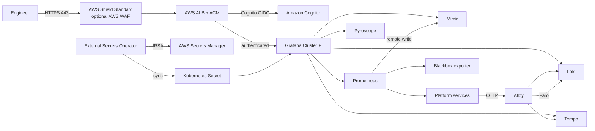

# Grafana on AWS

This page describes the prepared AWS deployment. It is **not applied**. The
local Docker Compose stack already hosts Prometheus, Mimir, Loki, Tempo,
Pyroscope, Graphite, Telegraf, Grafana, Alloy and blackbox.

## Topology



Grafana is never exposed with a `LoadBalancer` Service or a public ALB without
authentication. The ALB uses Cognito; Grafana sees only authenticated requests.
Without a custom domain, the supported access path is `kubectl port-forward` or
SSM. The ALB + Cognito option needs an ACM certificate and a DNS name. See
[custom domains](../infrastructure/custom-domains.md).

## What the repository provides

| Asset | Purpose |
| --- | --- |
| `observability/helm/values.yaml` | kube-prometheus-stack with Grafana/Alertmanager disabled |
| `k8s/observability/grafana.yaml` | Grafana Deployment, PVC and ClusterIP Service |
| `k8s/observability/mimir.yaml` | Long-term metrics, 10 GiB PVC |
| `k8s/observability/loki.yaml` | Logs, 10 GiB PVC |
| `k8s/observability/tempo.yaml` | OTLP traces, 10 GiB PVC |
| `k8s/observability/pyroscope.yaml` | Profiles, 10 GiB PVC |
| `k8s/observability/alloy.yaml` | OTLP, Faro and pod-log collector |
| `k8s/observability/blackbox.yaml` | In-cluster blackbox exporter |
| `k8s/observability/servicemonitors.yaml` | Scrapes all six services |
| `k8s/base/otel-instrumentation.yaml` | Java agent init container and OTel env |
| `k8s/observability/probe.yaml` | External CloudFront synthetic checks |
| `k8s/observability/grafana-ingress-cognito.example.yaml` | ALB + Cognito ingress |
| `k8s/observability/external-secret.example.yaml` | Secrets Manager → Kubernetes |
| `scripts/install-observability.sh` | Creates ConfigMaps, PrometheusRule and Helm release |
| `terraform/environments/aws` | Optional EBS CSI, secret containers |
| `terraform/environments/grafana-cloud` | Cloud dashboards, alerts and synthetic checks |

## Prerequisites

1. **EBS CSI driver and a `gp3` StorageClass.** Terraform creates the IRSA role
   and add-on when `enable_observability = true`; the install script applies the
   `gp3` StorageClass.
2. **AWS Load Balancer Controller** with IRSA. It is not installed by this
   repository; install it once per cluster.
3. **Cognito user pool, app client and domain** for the ALB authentication
   action. Restrict sign-up: admins create users.
4. **ACM certificate** in the ALB region and a DNS record for the Grafana host.
   Without a custom domain there is no stable ALB TLS hostname; use
   `kubectl port-forward` for now.
5. **External Secrets Operator** or an equivalent secret sync. The example uses
   a `ClusterSecretStore` named `aws-secrets-manager`.
6. **Kubernetes context** for the target EKS cluster.

> [!WARNING]
> Applying Terraform or Helm changes AWS resources. Get explicit owner
> authorization before running the commands below.

## Step 1 — Terraform preparation

Set the flag and apply:

```bash
export TF_VAR_enable_observability=true
export PATH="$HOME/.local/bin:$PATH"
terraform -chdir=terraform/environments/aws init
terraform -chdir=terraform/environments/aws apply
```

This adds:

- `aws-ebs-csi-driver` and its IRSA role;
- Secrets Manager containers `platform/grafana/admin` and
  `platform/grafana/alerting`.

The stack creates seven `gp3` PVCs (Prometheus, Mimir, Loki, Tempo, Pyroscope,
Grafana and Alloy). Expect the full stack to add a third `t3.medium` node.

Terraform does **not** write secret values and does **not** deploy the
observability stack; `scripts/install-observability.sh` does that in Step 3.

## Step 2 — Write secrets out of band

Use the prompt-based script; the password is not echoed and does not enter shell
history:

```bash
scripts/create-grafana-secrets.sh
```

It writes:

| Secret | Keys | Consumer |
| --- | --- | --- |
| `platform/grafana/admin` | `username`, `password` | `grafana-admin` Kubernetes Secret |
| `platform/grafana/alerting` | `email_to` | `grafana-alerting` Kubernetes Secret |

Do **not** put these values in `terraform.tfvars`, Helm values, Git, CI logs or
dashboards. Terraform only creates the containers.

### Option A — External Secrets Operator

Apply `k8s/observability/external-secret.example.yaml` after creating the
`aws-secrets-manager` ClusterSecretStore and an IRSA role that can read
`platform/grafana/*`.

### Option B — direct Kubernetes Secret for a first install

```bash
export GRAFANA_ADMIN_PASSWORD='read-from-a-password-manager'
kubectl -n observability create secret generic grafana-admin \
  --from-literal=admin-user=admin \
  --from-literal=admin-password="$GRAFANA_ADMIN_PASSWORD"
unset GRAFANA_ADMIN_PASSWORD
```

This is acceptable for a short-lived demo but not as a long-term process.

## Step 3 — Install the stack

```bash
scripts/install-observability.sh
```

The script:

1. Creates the `observability` namespace.
2. Creates or reuses `grafana-admin` and `grafana-alerting`.
3. Creates ConfigMaps for Grafana provisioning, dashboards, blackbox, Mimir,
   Loki, Tempo, Pyroscope and Alloy.
4. Converts the recording rules into a `PrometheusRule`.
5. Installs `kube-prometheus-stack` with Grafana and Alertmanager disabled.
6. Applies Mimir, Loki, Tempo, Pyroscope, Alloy, Grafana, blackbox,
   ServiceMonitors, Probe and NetworkPolicy.
7. Waits for every observability Deployment to roll out.

Prometheus remote-writes to Mimir. Alloy receives OTLP traces from the Java
agent, reads Kubernetes pod logs, and accepts Faro browser telemetry. Access
Grafana through a port-forward first:

```bash
kubectl -n observability port-forward svc/grafana 3000:3000
open http://localhost:3000
```

Faro ingest is `alloy.observability.svc.cluster.local:12347/collect` inside the
cluster and `https://<CloudFront-domain>/faro/collect` for browsers. The
CloudFront `/faro/*` path is prepared behind `enable_faro_ingest = false` and
reuses the existing NLB on HTTP port 8080 -> Alloy NodePort 30081. No new load
balancer or custom domain is required. See
[AWS observability assessment](../infrastructure/aws-observability-assessment.md).

## Step 4 — Publish behind an account

### Selected decision: ALB + Cognito (AWS-native)

This project chooses the AWS-native ALB + Cognito option. Cloudflare Tunnel +
Access remains an optional lower-infrastructure alternative, but it is not the
selected delivery path and should not be implemented without an explicit
operations decision.

Fill in the real domain, ACM ARN, user-pool ARN, client ID and Cognito domain in
`grafana-ingress-cognito.example.yaml`, rename it to `.yaml`, and apply it:

```bash
kubectl apply -f k8s/observability/grafana-ingress-cognito.yaml
```

The ALB:

- terminates TLS with ACM;
- redirects unauthenticated users to Cognito;
- allows only users in the configured pool;
- forwards authenticated traffic to the `grafana` ClusterIP Service.

Grafana additionally keeps `GF_AUTH_ANONYMOUS_ENABLED=false`,
`GF_USERS_ALLOW_SIGN_UP=false` and `GF_SECURITY_COOKIE_SECURE=true`. Cognito is
an additional gate, not a replacement for Grafana authorization. Attach a
separate AWS WAF web ACL to the ALB; the prepared `enable_waf` Terraform option
covers the CloudFront distribution, not this ALB. See
[AWS edge security](../infrastructure/aws-edge-security.md).

Configure Grafana before applying the ingress. The installer uses a local,
HTTP-safe default for port-forwarding; for the published hostname, provide the
real HTTPS URL and enable the matching security flags:

```bash
GRAFANA_ROOT_URL=https://grafana.example.com \
GRAFANA_ENFORCE_DOMAIN=true \
GRAFANA_COOKIE_SECURE=true \
scripts/install-observability.sh
```

Create Cognito groups such as `platform-admins` and `platform-viewers`, and map
them to Grafana roles with generic OAuth if Grafana-native login is not desired.
The ALB authentication alone does not assign Grafana roles.

### Option B — Wait for a domain

Without a custom domain there is no stable TLS hostname for a public ALB. Use
`kubectl port-forward` or an SSM session until a domain and ACM certificate are
available. See [Custom domains](../infrastructure/custom-domains.md).

## Step 5 — Verify

```bash
kubectl -n observability get pods
kubectl -n observability get svc grafana
kubectl -n observability get servicemonitor -A
kubectl -n observability get probe

kubectl -n observability port-forward svc/grafana 3000:3000 &
curl -fsS http://localhost:3000/api/health
curl -fsS -u admin:"$GRAFANA_ADMIN_PASSWORD" \
  'http://localhost:3000/api/search?type=dash-db'
```

Expected dashboards: Platform overview, Service RED, SLO and error budget,
Synthetic health, Dependencies.

Prometheus targets:

```bash
kubectl -n observability port-forward svc/observability-kube-prometheus-prometheus 9090:9090 &
curl -fsS 'http://localhost:9090/api/v1/targets?state=active'
```

## Credential map

| Secret | Stored in | Injected as | Rotation |
| --- | --- | --- | --- |
| Grafana admin | Secrets Manager `platform/grafana/admin` | `GF_SECURITY_ADMIN_PASSWORD` via `secretKeyRef` | rotate + restart |
| Alert recipient | Secrets Manager `platform/grafana/alerting` | `ALERT_EMAIL_TO` via `secretKeyRef` | update + restart |
| Cognito client secret | Secrets Manager or Cognito console | ALB auth action / Grafana OAuth | new client secret + restart |
| SMTP password | Secrets Manager | `GF_SMTP_PASSWORD` | provider rotation |
| Grafana Cloud token (optional) | Grafana Cloud / secret store | Alloy environment | rotate access policy |
| AWS access | GitHub OIDC → IAM role | Actions | no static keys |

No secret value belongs in a Terraform variable, Helm value, provisioning file,
dashboard JSON or CI workflow.

## Front-door implementation checklist

The following is a documentation and operations checklist; it requires AWS
authorization and an operator to provision resources.

- [ ] Install the AWS Load Balancer Controller with IRSA.
- [ ] Create or confirm an ACM certificate for the Grafana hostname.
- [ ] Create a public or private Route 53 record pointing to the ALB.
- [ ] Create the Cognito user pool, app client and hosted domain.
- [ ] Fill `k8s/observability/grafana-ingress-cognito.example.yaml`.
- [ ] Set `GF_AUTH_ANONYMOUS_ENABLED=false`.
- [ ] Set `GF_USERS_ALLOW_SIGN_UP=false`.
- [ ] Set `grafana-config.root-url` to the HTTPS hostname.
- [ ] Set `grafana-config.enforce-domain=true`.
- [ ] Set `grafana-config.cookie-secure=true`.
- [ ] Store Grafana and Cognito secrets in Secrets Manager with ESO injection.
- [ ] Verify unauthenticated requests redirect to Cognito and authorized users
  reach Grafana.

## Cost

| Item | Estimate |
| --- | ---: |
| Prometheus/Grafana/blackbox requests | ~0.8–1.2 vCPU, ~2–3 GiB |
| Mimir/Loki/Tempo/Pyroscope/Alloy requests | ~0.5–1 vCPU, ~1.2–2 GiB |
| 70 GiB EBS (Prometheus 20, Grafana 10, four backends 10 each) | ≈ $7/month |
| Extra node if the two-node baseline cannot fit | ≈ +$31/month |
| ALB 24/7 | ≈ $20/month |
| Cognito, ACM, Route 53 | effectively free at this scale |
| Secrets Manager | ≈ $0.40/secret/month |
| AWS WAF (optional) | web ACL + request charges |

The current two-node run-rate is ≈ $240/month. Observability likely adds a third
node; see [Costs, PaaS and SLA](../infrastructure/costs.md).

## Rollback

```bash
helm uninstall observability -n observability
kubectl delete -k k8s/observability
kubectl delete namespace observability
```

This deletes the Prometheus, Grafana, Mimir, Loki, Tempo, Pyroscope and Alloy
PVCs. The Secrets Manager containers and EBS CSI add-on remain until Terraform
is changed. Optional Grafana Cloud data is retained by its own stack policy.

## Remaining work

- Install and verify the AWS Load Balancer Controller and Cognito flow in the
  live account.
- Decide whether Grafana keeps native login or delegates to Cognito OIDC.
- Add the Exchange Python OpenTelemetry integration in its own repository.
- Add Pyroscope language agents and decide the sampling/overhead budget.
- Attach AWS WAF and enable CloudFront/WAF logging.
- Enable the prepared CloudFront `/faro/*` path (`enable_faro_ingest = true`) and
  set the production frontend `NEXT_PUBLIC_FARO_URL` before claiming browser
  telemetry.
- Add a custom domain and ACM certificate; the CloudFront hostname is still the
  public application URL. See [Custom domains](../infrastructure/custom-domains.md).
- Optionally apply the Grafana Cloud Terraform environment; it is not required.
