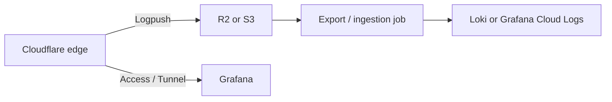

# Cloudflare edge telemetry

The platform uses two different products with similar names:

- **Grafana Cloud** is the observability backend: metrics, logs, traces,
  profiles, Faro, synthetic checks and alerting.
- **Cloudflare** is the security edge: DDoS protection, WAF, Tunnel and Access.
  It is **not** the metrics backend.

This page covers the optional Cloudflare edge path so the two are not confused.
Nothing here is provisioned.

## Signal map

| Cloudflare capability | Signal | Platform use | Status |
| --- | --- | --- | --- |
| WAF / DDoS analytics | Security events | Incident review, abuse trends | Plan-dependent, not exported |
| Logpush | HTTP request logs | Edge request analysis in Loki | Optional; depends on plan |
| R2 | Log archive | Durable Logpush destination | Alternative to S3; not approved |
| Workers Analytics Engine | Custom edge counters | Not used | Not implemented |
| Web Analytics / RUM | Browser performance | Faro is the selected browser path | Not used |
| Tunnel | Private origin connectivity | Reach Gateway or Grafana without inbound ports | Planned security option |
| Access | Identity-aware proxy | Protect Grafana/admin tools | Planned security option |

## If you meant Grafana Cloud

Use [Observability](observability.md) and
[Grafana on AWS](grafana-aws.md). The Alloy configuration in
[`observability/alloy/config.cloud.alloy`](https://github.com/Microsserv52/platform/blob/main/observability/alloy/config.cloud.alloy)
already maps every backend signal to the Grafana Cloud endpoints:

- Prometheus remote write → Mimir;
- Alloy Docker logs → Loki;
- OTLP traces → Tempo;
- Pyroscope write endpoint;
- Faro receiver for local browser telemetry.

The frontend sends Faro directly to the Grafana Cloud Frontend Observability
collector in production. No Grafana Cloud token is embedded in browser code.

## If you meant Cloudflare Logpush

Cloudflare Logpush can deliver request logs to a supported destination. The
available datasets and destinations depend on the plan.

A safe first step is an R2 bucket or an existing S3 bucket with:

- object lifecycle and retention;
- encryption;
- least-privilege write access for the Cloudflare Logpush role;
- redaction of cookies, authorization headers and query strings before export;
- a documented retention and cost budget.

The repository does **not** include a Logpush job because the Cloudflare zone,
plan and destination are not provisioned. Adding one requires:

1. A Cloudflare zone and API token with Logpush permissions.
2. A destination bucket and credentials.
3. A reviewed field list that excludes personal data and secrets.
4. A test export and a query in Grafana.
5. A retention and deletion policy.

Do not route presigned S3 uploads through Cloudflare Tunnel or rewrite signed
host/path/headers. Keep the media upload origin separate from the security edge.

## Protect Grafana with Cloudflare Access

This is the near-zero-cost alternative to the AWS ALB + Cognito door:

1. Run `cloudflared` in the `observability` namespace.
2. Create a tunnel to `http://grafana.observability.svc.cluster.local:3000`.
3. Add a public hostname such as `grafana.example.com`.
4. Create a Cloudflare Access application for that hostname.
5. Allow only the `platform-admins` and `platform-viewers` identity groups.
6. Enable MFA and a short session duration.
7. Keep Grafana `GF_AUTH_ANONYMOUS_ENABLED=false` and sign-up disabled.

The connector token and Access service token belong in Kubernetes Secrets or a
secret manager. They must never be committed.

## Verification checklist

- [ ] A request from an unauthenticated browser is blocked before Grafana.
- [ ] An allowed user reaches Grafana and sees the dashboards.
- [ ] A direct pod IP or port-forward path is not exposed publicly.
- [ ] Logpush, if enabled, excludes cookies, tokens and personal data.
- [ ] Retention and cost are documented.
- [ ] Disabling the edge path leaves the internal stack reachable by operators.

## Related

- [Cloudflare security edge](../infrastructure/cloudflare.md)
- [Observability](observability.md)
- [Grafana on AWS](grafana-aws.md)
