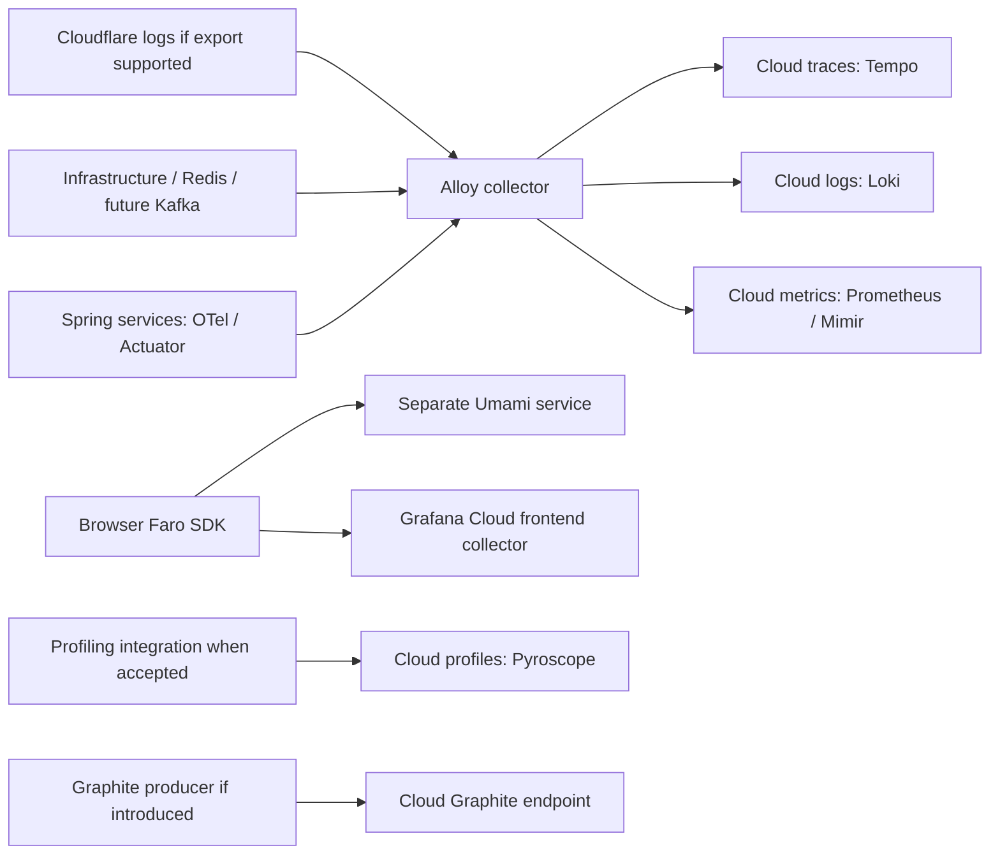

# Observability

Observability makes it possible to understand a request without reproducing it
locally. The platform should cover logs, metrics and traces across the Gateway
and every downstream service.

## Signals

### Logs

Emit structured JSON logs with:

- UTC timestamp and severity;
- service and environment;
- request or trace ID;
- HTTP method, route template and status;
- duration in milliseconds;
- dependency name and outcome when applicable.

Do not log passwords, access tokens, API keys, full authorization headers or
unredacted personal data.

### Metrics

At minimum, expose:

| Metric                              | Purpose                         |
| ----------------------------------- | ------------------------------- |
| Request count by route and status   | Traffic and error rate          |
| Request latency percentiles         | User-facing performance         |
| In-flight requests                  | Saturation                      |
| Dependency failures and latency     | Locate slow downstream services |
| Database connection pool usage      | Detect persistence pressure     |
| Pod CPU and memory                  | Capacity and autoscaling        |
| Exchange provider rate and failures | Monitor external dependency     |

Use low-cardinality labels. Never use user IDs, order IDs or unrestricted URLs
as metric labels.

### Traces

Propagate a trace context from Gateway through Product, Order, Account, Auth and
Exchange. A trace for `POST /orders` should show product lookup, persistence
and any exchange call as separate spans.

## Health endpoints

Every service should provide:

- **liveness**: the process is running;
- **readiness**: the service can receive traffic and required dependencies are
  available;
- **info/version**: build version and commit identifier without secrets.

Readiness should be used by load balancers and Kubernetes; liveness must not
restart a service merely because an optional external provider is temporarily
unavailable.

## Dashboards and alerts

Create dashboards for traffic, errors, latency, saturation and dependency
health. Alert on symptoms such as elevated 5xx rate, failed readiness checks,
high latency, pod restarts and database exhaustion. Every alert must link to a
runbook and identify an owner.

Grafana Cloud is selected. Stack region/endpoints, retention, sampling, access
and budget values remain deployment decisions. There is no self-hosted LGTM
backend in this checkout.

## Selected Grafana Cloud stack

The owner selected Grafana Cloud as the managed observability destination.
Its [managed telemetry backends](https://grafana.com/docs/learning-paths/grafana-cloud-tour/explore-send-data/)
map signals as follows; this is the target, not a claim that ingestion is live.

| Technology                | Role and planned usage                                                                        | Current status                                                                                      |
| ------------------------- | --------------------------------------------------------------------------------------------- | --------------------------------------------------------------------------------------------------- |
| Grafana Cloud / Grafana   | Managed dashboards, exploration and alerting                                                  | Selected; stack/region/access/alerts not configured.                                                |
| Prometheus / Mimir        | Prometheus-compatible application and infrastructure metrics                                  | Selected; application metrics exporter/scrapes/remote write not configured.                         |
| Loki                      | Structured service, edge and infrastructure logs                                              | Selected; ingestion and redaction pipeline not configured.                                          |
| Tempo                     | Distributed traces across Gateway, services and later Kafka consumers                         | Selected; backend propagation/export not implemented.                                               |
| Pyroscope                 | Continuous CPU/allocation profiling where supported                                           | Selected capability; language integration, sampling and overhead budget pending.                    |
| Faro                      | Browser errors, performance and tracing into Grafana Cloud Frontend Observability             | SDK already integrated; collection disabled pending deployment values/policy.                       |
| OpenTelemetry (OTel/OTLP) | Vendor-neutral instrumentation, trace propagation and export                                  | Planned backend integration; no new agent/SDK installed by this decision.                           |
| Alloy                     | Collector with OpenTelemetry and Prometheus pipelines, routing telemetry to the managed stack | Planned collector, not deployed.                                                                    |
| Graphite                  | Graphite metric ingestion/query support for Graphite-format producers                         | Supported capability; no current producer. Prometheus/OTel is the proposed default for new metrics. |
| Umami                     | Separate privacy-conscious demo usage analytics                                               | Existing gated script integration; not a Grafana backend or tracing replacement.                    |
| k6                        | Controlled load testing and optional Grafana Cloud test integration                           | Local script exists; no hosted test or capacity claim.                                              |

[Alloy](https://grafana.com/docs/grafana-cloud/send-data/alloy/introduction/) can
collect multiple telemetry signals. [Graphite support](https://grafana.com/docs/grafana-cloud/send-data/metrics/metrics-graphite/)
is available, but Grafana recommends Prometheus for new metrics. We do not need
to emit the same metric into both systems or operate standalone Graphite/Loki/
Tempo/Mimir servers to use their managed Cloud services.

### Proposed signal flow

Use one owned collection path per signal to avoid duplicate ingestion. The
proposed baseline is structured application logs collected by Alloy,
Prometheus-compatible metrics, and OTel backend traces exported through Alloy.
Evaluate an official Java agent/framework integration and the required metrics
registry before implementation; ask for dependency/agent approval first. The
existing health endpoint alone is not a Prometheus exporter.

Browser ingestion uses the public Faro collector configuration, not private
Grafana Cloud access tokens. Backend OTLP/remote-write/log credentials stay in
the collector's secret store. Preserve existing redaction, Do Not Track and
opt-out behavior. Trace continuity from private browser routes is currently
restricted; extending propagation requires privacy/CORS review rather than
claiming end-to-end traces already work.

Start with service/environment/release/route-template labels. Do not put user,
cart, order, product IDs, raw URLs or search text into metric labels. Strip
cookies, credentials, authorization headers, signed upload query strings and
personal data before telemetry leaves the application/collector. Use bounded
sampling, retention and ingestion budgets; set alerts for errors, latency,
cart Redis saturation/failed writes, outbox backlog and Kafka consumer lag.
Cloudflare log export depends on plan and log availability.

### Rollout and verification

1. Choose Grafana Cloud stack/region, endpoint scopes, data retention, budget,
   dashboard roles, alert destinations and collection policy. Umami hosting and
   values are separate decisions.
2. Approve and initialize the official collector/agent/framework integrations.
   Keep development, staging and future production identities distinct.
3. Verify a controlled request across Gateway and a downstream service, then
   inspect correlated logs, trace spans and metrics without sensitive data.
4. Verify browser payload redaction, opt-out, allowed origins, edge WAF behavior,
   collector failure isolation, bounded buffering and telemetry cost/overhead.
5. Add Redis/Cart and Kafka/outbox dashboards when those services exist.
   Do not run load tests against production without explicit authorization.

## Browser observability integration

The three web applications integrate **Grafana Faro** for browser errors,
performance and tracing, and **Umami** for demo product-usage analytics. The
[frontend PWA and observability plan](../frontend/pwa-observability.md) defines
application identities, sanitized events, environment variables, deployment
choices and verification. Collection is disabled by default. Grafana Cloud collector values, Umami hosting and retention remain to be
confirmed at deployment; admin usage
analytics are excluded.

The store is a simulation. Analytics must describe **demo orders**, never real
payments or revenue, and must exclude credentials, personal identifiers and
raw search/order/account URLs.
