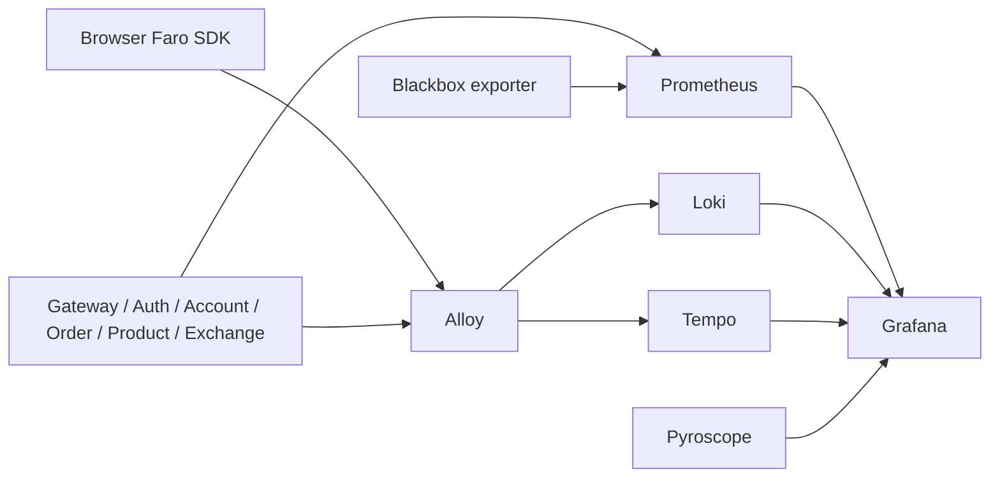

# Observability

Observability makes it possible to understand a request without reproducing it
locally. The platform covers logs, metrics, traces and profiles across the
Gateway and every downstream service.

The stack is implemented as configuration-as-code under
[`observability/`](https://github.com/Microsserv52/platform/tree/main/observability).
It runs on Docker Compose for the daily loop, can be installed into the
LocalStack EKS rehearsal, and has a prepared EKS deployment path.

> [!NOTE]
> **Signals are live locally; AWS deployment is prepared, not applied.** The
> repository contains the Helm values, Kubernetes manifests and Terraform
> prerequisites. Deploying them changes AWS resources and needs owner
> authorization.

## Signals

### Metrics

| Service | Endpoint | Instrumentation |
| --- | --- | --- |
| Gateway | `/actuator/prometheus` | Micrometer, HTTP server metrics and latency histogram |
| Auth | `/actuator/prometheus` | Micrometer, HTTP server metrics and latency histogram |
| Account | `/actuator/prometheus` | Micrometer, Hikari and HTTP server metrics |
| Order | `/actuator/prometheus` | Micrometer, Hikari and HTTP server metrics |
| Product | `/actuator/prometheus` | Micrometer, Hikari, cache and HTTP server metrics |
| Exchange | `/metrics` | `prometheus-client`, provider, cache and HTTP metrics |

All Java services tag metrics with `application`, and Prometheus adds a
`service` label. Dashboards and alerts use the `service` label, not pod names.
Latency histograms are enabled with:

```properties
management.metrics.distribution.percentiles-histogram.http.server.requests=true
management.metrics.distribution.slo.http.server.requests=50ms,100ms,250ms,500ms,1s,2s,5s
```

### Logs

Services emit structured JSON with UTC timestamps, service, request ID, route
and status. Alloy reads Docker container logs locally and writes them to Loki.
In Grafana Cloud, the same Alloy pipeline writes to the Cloud Loki endpoint.
Secrets, JWTs and provider credentials are never logged.

### Traces

Tempo is part of the local stack and Alloy accepts OTLP on `4317`/`4318`.
Browser traces travel through Alloy's Faro receiver. Java and Python services
need an OpenTelemetry agent or SDK before backend spans are exported; the
collector path and Tempo/Grafana Cloud endpoints are ready.

### Profiles

Pyroscope is part of the local stack. The Cloud write path is configured in
Alloy. CPU/allocation profiling still needs a language agent and an overhead
decision; no profiler is claimed as enabled.

## Local stack



Start the application and observability profile:

```bash
docker compose -f compose.yml -f compose.observability.yml \
  --profile observability up -d
```

Or use the wrapper:

```bash
scripts/observability-up.sh
```

| Component | Local URL | Purpose |
| --- | --- | --- |
| Grafana | <http://localhost:3000> | Dashboards, unified alerting |
| Prometheus | <http://localhost:9090> | Metrics, recording rules |
| Loki | <http://localhost:3100> | Logs |
| Tempo | <http://localhost:3200> | Traces |
| Pyroscope | <http://localhost:4040> | Profiles |
| Alloy | <http://localhost:12345> | Collection, Faro receiver |
| Blackbox | <http://localhost:9115> | Synthetic HTTP probes |

All ports bind to `127.0.0.1`. Stop without deleting data:

```bash
scripts/observability-down.sh
```

Enable browser telemetry before rebuilding the frontends:

```bash
NEXT_PUBLIC_ENABLE_TELEMETRY=true
NEXT_PUBLIC_FARO_URL=http://localhost:12347/collect
```

The admin app also links to `NEXT_PUBLIC_GRAFANA_DASHBOARD_URL` when set.

### LocalStack rehearsal

LocalStack EKS uses k3s with a single tainted control-plane node and no dynamic
`gp3` provisioner. Install the same stack with emptyDir storage:

```bash
scripts/install-observability.sh --localstack
```

It uses [`values.localstack.yaml`](https://github.com/Microsserv52/platform/blob/main/observability/helm/values.localstack.yaml)
and the overlay in
[`k8s/overlays/localstack/observability`](https://github.com/Microsserv52/platform/tree/main/k8s/overlays/localstack/observability).
The external `Probe` is omitted there because the rehearsal has no public edge.

## Dashboards

| Dashboard | UID | Main questions |
| --- | --- | --- |
| Platform overview | `platform-overview` | Is traffic healthy? Which service is burning? |
| Service RED | `service-red` | Rate, errors and duration for one service |
| SLO and error budget | `slo-error-budget` | 28-day availability, burn rate, remaining budget |
| Synthetic health | `synthetic-health` | Are edge pages and API probes succeeding? |
| Dependencies | `dependencies` | Hikari, Redis/cache and Exchange provider health |

Dashboards are provisioned from
[`observability/grafana/dashboards`](https://github.com/Microsserv52/platform/tree/main/observability/grafana/dashboards).
Every dashboard uses the provisioned `prometheus` datasource UID, so the same
JSON works locally and on EKS.

## SLIs, SLOs and alerts

The 28-day availability SLO is **99.5%** for the service set. The error budget is
0.5%. Recording rules in
[`observability/prometheus/rules/sli.yml`](https://github.com/Microsserv52/platform/blob/main/observability/prometheus/rules/sli.yml)
compute:

- request and error rate by service;
- availability at 5 minutes and 28 days;
- p95 and p99 latency;
- burn rate and remaining error budget;
- JVM heap and Hikari utilization.

Grafana unified alerting is provisioned from
[`observability/grafana/provisioning/alerting/rules.yml`](https://github.com/Microsserv52/platform/blob/main/observability/grafana/provisioning/alerting/rules.yml).

| Alert | Condition | Severity |
| --- | --- | --- |
| Platform availability fast burn | availability < 99% for 5m | page |
| Platform availability slow burn | availability < 99.5% for 30m | ticket |
| Platform p95 latency above 1s | p95 > 1s for 10m | ticket |
| Platform scrape target down | `up == 0` for 2m | page |
| Synthetic edge probe failing | `probe_success == 0` for 2m | page |
| Database connection pool saturation | Hikari > 90% for 5m | ticket |
| Exchange provider errors | error rate > 0.1/s for 5m | page |
| Product cache errors | cache error rate > 0 for 10m | ticket |

Email is the default contact point (`ALERT_EMAIL_TO`). A Slack example is kept
as `observability/grafana/examples/contact-points.slack.example.yml`; copy it into the alerting provisioning directory as `.yml` and set
`ALERT_SLACK_WEBHOOK_URL` to enable it.

### Alert runbook

<div id="alert-runbook"></div>

1. Open **Platform overview** and identify the affected `service`.
2. Open **Service RED** and compare request rate, 5xx ratio and p95.
3. Check **Dependencies** for Hikari saturation, Exchange provider errors and
   cache errors.
4. Check **Synthetic health** to separate an edge/CloudFront problem from a
   service problem.
5. For availability or latency incidents, inspect `kubectl -n platform logs`
   and the Grafana Loki explorer with the `service` label.
6. For Hikari saturation, compare `hikaricp_connections_active` with
   `hikaricp_connections_max`; the retained pool is 8 per pod.
7. Record the incident and link the dashboard time range in the delivery notes.

## Grafana Cloud ingestion

Grafana Cloud remains the managed destination for signals that should outlive
the cluster. All credentials are environment variables; no token is committed.

| Grafana Cloud product | Role | Repository status |
| --- | --- | --- |
| Prometheus / Mimir | Metrics remote write | Configured in `observability/alloy/config.cloud.alloy` |
| Loki | Logs | Configured through Alloy Docker log collection |
| Tempo | Traces | OTLP receiver and Cloud exporter configured |
| Pyroscope | Profiles | Cloud write endpoint configured; agent pending |
| Faro / Frontend Observability | Browser errors, Web Vitals, traces | Frontend SDK present; URL remains a deployment value |
| Synthetic Monitoring | External checks | Terraform in `terraform/environments/grafana-cloud` |
| Grafana Alerting | Unified alerting | Provisioned locally; Cloud contact points are Terraform-managed |
| k6 | Load tests | Local k6 scenarios; remote-write output is optional |

Required environment for the Cloud collector:

```bash
GRAFANA_CLOUD_PROMETHEUS_URL=
GRAFANA_CLOUD_PROMETHEUS_USER=
GRAFANA_CLOUD_LOKI_URL=
GRAFANA_CLOUD_LOKI_USER=
GRAFANA_CLOUD_OTLP_ENDPOINT=
GRAFANA_CLOUD_PYROSCOPE_URL=
GRAFANA_CLOUD_PYROSCOPE_USER=
GRAFANA_CLOUD_API_KEY=
```

Cloud dashboards and synthetic checks are created from
[`terraform/environments/grafana-cloud`](https://github.com/Microsserv52/platform/tree/main/terraform/environments/grafana-cloud).
The environment validates without credentials; applying it needs a Grafana
Cloud stack URL, service-account token and Synthetic Monitoring access token.

## AWS deployment

The prepared EKS deployment runs Prometheus Operator and self-hosted Grafana;
Grafana stays `ClusterIP` and is published behind **Amazon Cognito** at an ALB,
or behind **Cloudflare Access/Tunnel**. The cluster installer provisions the
in-cluster Prometheus datasource; logs, traces and profiles stay in Grafana
Cloud and are queried from the Cloud UI, so there are no broken in-cluster
Loki/Tempo/Pyroscope datasources on EKS. See
[Grafana on AWS](grafana-aws.md) for the topology, prerequisites, secret flow
and exact commands.

## Cloudflare edge

Cloudflare is the security edge, not the metrics backend. Edge logs can be
exported with Logpush when the plan allows it; the optional path is documented
in [Cloudflare edge telemetry](observability-cloudflare.md). It does not replace
the Grafana Cloud signal pipeline.

## Verification

```bash
scripts/validate-observability.sh

curl -fsS http://localhost:9090/-/ready
curl -fsS 'http://localhost:9090/api/v1/targets?state=active'
curl -fsS 'http://localhost:9090/api/v1/query?query=probe_success'
curl -fsS http://localhost:3000/api/health
curl -fsS -u admin:admin http://localhost:3000/api/search?type=dash-db
```

The validation script checks Prometheus configuration and rules with
`promtool`, the blackbox configuration, dashboard JSON and provisioning YAML.

## Cost

| Item | Local | AWS estimate |
| --- | ---: | ---: |
| Prometheus + Grafana + blackbox requests | $0 | ~0.8–1.2 vCPU, ~2–3 GiB |
| EBS for Prometheus (20 GiB) + Grafana (10 GiB) | $0 | ≈ $2.5/month |
| Extra node if the two-node baseline cannot fit | $0 | ≈ +$31/month |
| Grafana Cloud | Free tier possible | Plan-dependent |

The observability stack likely pushes the current two-node baseline to three
nodes. See [Costs, PaaS and SLA](../infrastructure/costs.md).

## Known limits

- Backend traces and profiles need an OpenTelemetry/profiling agent; only the
  collector and storage paths are configured.
- AWS deployment is prepared and validated, not applied.
- Grafana Cloud Terraform cannot be applied without a real stack and tokens.
- LocalStack stores Prometheus/Grafana data in emptyDir; it is a rehearsal, not
  durable storage.
- Cloudflare Logpush availability depends on the selected plan.
