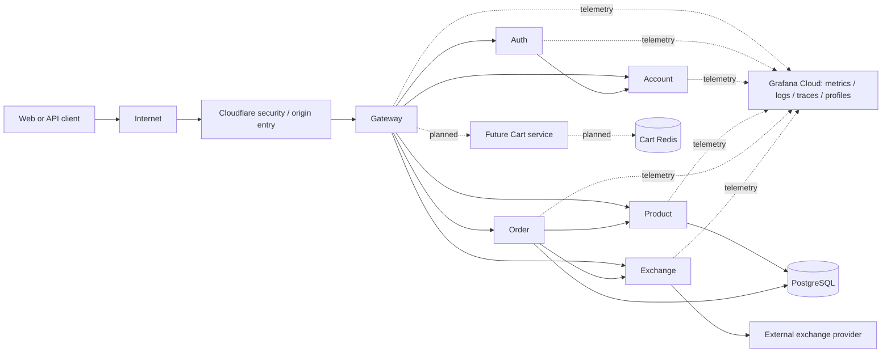
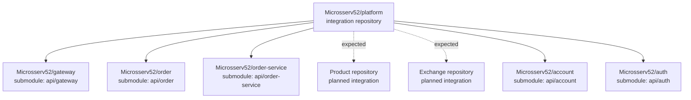
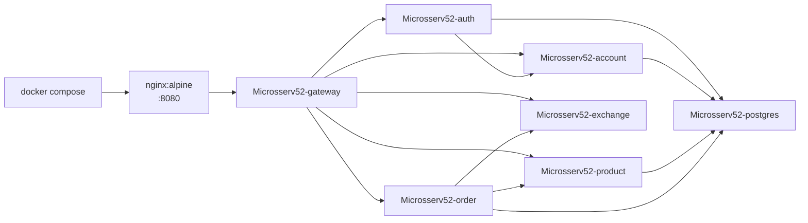
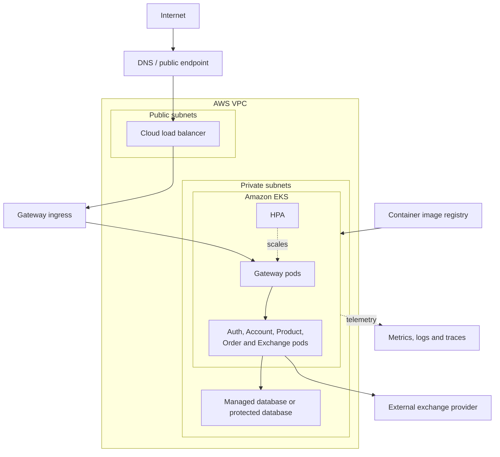
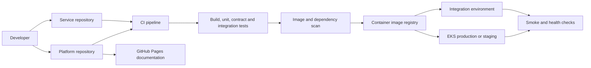

# Architecture

This page describes the complete platform workflow: source repositories,
service ownership, container images, local execution, cloud deployment and
external dependencies. It distinguishes the architecture required by the
project from the parts currently present in this repository.

## Technology inventory and badge status

The platform and organization READMEs list the complete technology inventory,
with each service README limited to its own dependencies and tools. Badges
identify technologies, not proof of deployment.

Redis is selected for a dedicated Cart service: carts expire seven days after the last change; reads do not renew TTL. The service is not implemented yet; the current Store still uses browser storage. Existing Redis endpoint wiring does not provide carts or service-level caching. The Store PWA remains online-only.

AWS/EKS/ECR deployment configuration and the VPC/RDS target architecture are documented; this does not mean cloud resources are provisioned. S3 + CloudFront and the AWS SDK are approved for the future Product backend; real image persistence is pending.

Grafana Cloud is selected for observability: Prometheus-compatible/Mimir metrics, Loki logs, Tempo traces, Pyroscope profiles, Faro, OpenTelemetry/Alloy and Graphite support. New metrics should use Prometheus/OTel; Graphite is available for Graphite-format producers. Collection and cloud provisioning remain pending. Umami stays a separate analytics integration. Cloudflare is selected for DDoS protection, WAF and Tunnel; its security role does not choose the frontend CDN or domain, both of which remain open. Cloudflare R2 is still only an alternative, not a replacement for approved S3 storage. Kafka placement is proposed for post-order events and later Product background work; no broker or client is implemented.

See the [Cart service](../services/cart/index.md), [Kafka proposals](asynchronous-events.md),
[Grafana Cloud plan](../operations/observability.md) and
[Cloudflare edge](../infrastructure/cloudflare.md) for boundaries and rollout.

## System context

### Request workflow

1. A client sends an HTTPS request to the public load balancer or edge proxy.
2. The edge proxy forwards the request to Gateway; internal services are not
   public client entry points.
3. Gateway routes the request and applies cross-cutting policies such as
   request limits, CORS and access logging.
4. Auth validates the access token. Auth uses Account for user status,
   credentials and roles; it does not own Account's database.
5. Gateway forwards the authenticated identity to the target business service.
6. Product handles catalogue operations. Order validates products and obtains
   their current prices from Product before persisting an order.
7. Order stores monetary values in USD. For a requested target currency, Order
   calls Exchange, which calls the configured external provider.
8. Services emit correlated logs, metrics and traces for the request.
9. The response travels back through Gateway and the edge proxy to the client.

## Source repositories

The root repository is the integration and documentation repository. Each
service has its own lifecycle and is included in the root repository through a
Git submodule when integrated.

### Repository responsibilities

| Repository or path           | Responsibility                                                 | Current status                                        |
| ---------------------------- | -------------------------------------------------------------- | ----------------------------------------------------- |
| `Microsserv52/platform`      | Integration, Compose topology, docs and cross-service delivery | Present                                               |
| `Microsserv52/gateway`       | Public routing and edge policies                               | Submodule present                                     |
| `Microsserv52/order`         | Java Order API implementation                                  | Submodule present                                     |
| `Microsserv52/order-service` | Order service-layer integration and image source               | Submodule present                                     |
| Product repository           | Product API and product image                                  | Required by target architecture; not a root submodule |
| Exchange repository          | Python Exchange API and provider adapter                       | Required by target architecture; not a root submodule |
| `Microsserv52/account`       | Registration and account management                            | Submodule present                                     |
| `Microsserv52/auth`          | Login, token issuance and validation                           | Submodule present                                     |

The root repository records exact submodule commits. A service change is
implemented and reviewed in its service repository first; the integration
repository then updates the submodule pointer and verifies the complete stack.

### Frontend repositories

The [frontend architecture](../frontend/architecture.md) integrates
`Microsserv52/landing`, `Microsserv52/store` and `Microsserv52/admin` as
`web/landing`, `web/store` and `web/admin`. Independent Next.js applications
share one domain through path routing at `/`, `/store` and `/admin`.
The local edge routes web pages to the static exports while Gateway remains
the business API boundary at `/api/*` and the preserved legacy API paths.

The agreed experience is an English-language educational mock store with
public catalog browsing and authenticated demo orders. **No real payments or
transactions occur and no goods are shipped.** See the [site/content plan](../frontend/overview.md)
and [service prerequisites](../frontend/architecture.md#remaining-service-prerequisites).
Each frontend has a Dockerfile for local testing. Production frontends will
use CDN hosting with separate build environments; the owner must be consulted
when deployment begins. Frontend Kubernetes deployment is deferred. Browser
telemetry is integrated but disabled by default; the store PWA is online-only.
The diagrams elsewhere on this page describe backend deployment; see the
frontend architecture for the web path and API-owned cookie session boundary.

## Runtime services

| Service      | Owns                                       | Depends on                          | Container image name    |
| ------------ | ------------------------------------------ | ----------------------------------- | ----------------------- |
| Nginx / edge | Local public HTTP entry point and proxying | Gateway                             | `nginx:alpine`          |
| Gateway      | Routing and edge policies                  | Auth, Account and business services | `Microsserv52-gateway`  |
| Auth         | Tokens, authentication and authorization   | Account, database                   | `Microsserv52-auth`     |
| Account      | User registration and profile data         | Database                            | `Microsserv52-account`  |
| Product      | Product catalogue and prices               | Database                            | `Microsserv52-product`  |
| Order        | Orders, ownership and totals               | Database, Product, Exchange         | `Microsserv52-order`    |
| Exchange     | Currency rates and provider adapter        | External provider                   | `Microsserv52-exchange` |
| Database     | Persistent relational data                 | Persistent storage                  | `Microsserv52-postgres` |

The image names above are the logical names currently referenced by
[`compose.yml`](../../compose.yml). The compose file does not specify a
registry hostname, so the final registry namespace and authentication must be
defined by the deployment environment.

## Local deployment

The local topology is declared in [`compose.yml`](../../compose.yml). Nginx
publishes port `8080`; the other services communicate through the Compose
network by service hostname. `depends_on` expresses startup ordering only; it
is not a readiness check, so services must still expose health and readiness
endpoints.

The current Compose file contains development database credentials. They must
be replaced with secrets before any shared or production deployment.

## Cloud deployment

The target cloud topology uses AWS with an EKS cluster, public subnets for
load-balancer resources and private subnets for application pods. A managed
database is preferred for production, with backups, encryption, restricted
network access and tested restoration. The exact region, instance sizes,
registry and managed database choice are deployment decisions that must be
recorded in [AWS](../infrastructure/aws.md), [EKS](../infrastructure/eks.md)
and [Costs](../infrastructure/costs.md).

## Build, image and deployment workflow

### Release flow

1. A developer changes the owning service repository and opens a pull request.
2. CI compiles, tests, scans and packages the service.
3. CI publishes an immutable image tag based on the commit or release.
4. The integration repository updates the submodule pointer and the image
   version used by the target environment.
5. A deployment pipeline applies the image to Compose, Kubernetes or the
   selected managed runtime.
6. Readiness checks, migrations, smoke tests and representative user flows are
   verified.
7. The release records service versions, image digests, test results and a
   rollback image.

The platform repository also publishes documentation through
[`.github/workflows/docs.yml`](../../.github/workflows/docs.yml). Application
CI/CD is owned by each runnable service repository, while this integration
repository performs cross-service validation and deployment coordination.

## External systems

| External system        | Interaction                                                | Required controls                                                    |
| ---------------------- | ---------------------------------------------------------- | -------------------------------------------------------------------- |
| AWS                    | VPC, EKS, load balancing, storage and monitoring           | IAM roles, MFA, least privilege, budgets and resource tags           |
| Container registry     | Stores service and database images                         | Immutable tags, access control and vulnerability scanning            |
| Exchange provider      | Supplies currency rates                                    | Timeout, bounded retry, provider key secret, fallback/error behavior |
| GitHub                 | Source repositories, submodules, pull requests and Actions | Branch protection, reviews and protected secrets                     |
| GitHub Pages           | Publishes generated documentation                          | Build verification and public-safe content                           |
| Observability platform | Receives logs, metrics and traces                          | Redaction, retention, access control and alert ownership             |

## Architecture decisions and boundaries

- Gateway is the only public application entry point.
- Services own their data and communicate through APIs, not shared tables.
- Product prices are read from Product when an order is created.
- Order stores USD and delegates conversion to Exchange.
- External providers are isolated behind adapters with explicit timeouts.
- Images are referenced by immutable versions in shared environments; `latest`
  is suitable only for local development.
- Secrets are injected at runtime and never committed to source control.

For detailed contracts, see [Service Contracts](../services/contracts.md).
For operational behavior, see [Observability](../operations/observability.md),
[Deployment](../infrastructure/deployment.md) and [CI/CD](../development/cicd.md).
