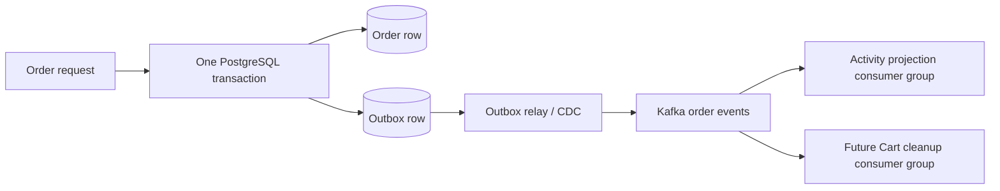

# Kafka opportunities and event boundaries

Kafka is a proposed backend event transport. No broker, producer, consumer or
Kafka dependency is implemented. The recommendations below are architecture
proposals; they do not introduce payments, shipping, stock reservations or real
customer communications into the mock store.

## Recommended priorities

| Priority | Producer and event                                          | Consumer/work                                                             | Why it fits / boundary                                                                                                                                                            |
| -------- | ----------------------------------------------------------- | ------------------------------------------------------------------------- | --------------------------------------------------------------------------------------------------------------------------------------------------------------------------------- |
| 1        | Order: `order.created.v1` after its database commit         | Demo order activity projection; revision-safe Cart cleanup                | Removes post-order side effects from request latency; the persisted order remains authoritative. A future projection API needs explicit access control.                           |
| 2        | Future Product: `product.image.uploaded.v1`                 | Bounded image validation, safe display variant generation, status updates | CPU-heavy work can scale separately. Pending uploads remain private; public URLs appear only after successful validation. This needs an approved asynchronous image API revision. |
| 3        | Future Product: `product.updated.v1` / `product.deleted.v1` | Search/read-model refresh and optional cache invalidation                 | Keeps optional projections decoupled; stale or deleted products must still be checked at checkout.                                                                                |
| Later    | Cart changes or application activity                        | Aggregated demo funnel analysis                                           | Only if a real consumer justifies the volume/retention. Faro/OTel and Umami are not replaced by domain events.                                                                    |

Start with Order events because Order source and PostgreSQL persistence exist.
An activity projection is a proposed first consumer, not an existing admin
report. Cart cleanup becomes useful when the Cart service exists. If no consumer
is needed yet, defer Kafka deployment rather than adding a broker solely to
transport unused events.

Do not put product lookup, login/session validation, Redis cart edits or the
authoritative order commit behind Kafka in the first iteration. Those request
flows need immediate validation/results. Kafka is a partitioned retained event
log, not a browser debounce queue or a generic delay scheduler. Consumer groups
allow independent subscribers to receive an event while workers in one group
share its partitions. Ordering is per partition, not across the whole topic.
See the official [Kafka design](https://kafka.apache.org/41/design/design/).

## Reliable first flow

Persist the order and its outbox event in one Order-owned database transaction.
A relay publishes committed outbox records and retries broker failures. A direct
database-write-then-publish sequence can lose events between the two operations.
Evaluate an established outbox integration, such as the
[Debezium outbox router](https://debezium.io/documentation/reference/stable/transformations/outbox-event-router.html),
instead of inventing a cross-system transaction. This is an option, not approval
to add Kafka Connect, Debezium or a new library now.

Treat delivery and external side effects as at least once. Deduplicate by a
stable event ID; commit a database projection's effect and deduplication record
in its own transaction before acknowledging the Kafka offset. Redis cleanup
needs a retry-safe, revision-aware operation. Kafka producer idempotence and
transactions do not provide automatic exactly-once effects in PostgreSQL,
Redis, S3 or external APIs.

A future Redis-only Cart producer cannot reuse Order's PostgreSQL outbox
transaction. Reliable cart-change publication needs its own accepted delivery
design; do not add a second authoritative cart store merely to emit events.

## Proposed contract and operations

- Use a versioned envelope: event ID/type/schema version, aggregate ID/version,
  UTC occurrence time, producer and sanitized trace context. Send bounded
  business identifiers and required payload fields, never session tokens,
  credentials, payment data or unnecessary personal details.
- Key Order events by order ID and Product events by product ID. Consumers
  handle stale aggregate versions and tombstones; a retry topic can reorder
  events and needs an explicit ordering policy.
- Use separate consumer groups for projection, Cart cleanup and image work.
  Additional consumers within a group share work; separate groups each receive
  their own stream.
- Use bounded retries and a dead-letter topic for poison events, with an
  operator-owned replay procedure. Do not add retry-topic libraries without
  approval. Kafka has no implicit per-message delay feature.
- Define retention, partitions, replication, acknowledgements, topic ACLs,
  TLS/SASL, schema compatibility and payload limits before deployment. Hosting
  (managed Kafka/MSK or self-operated), cost and dependencies remain undecided.
- Monitor outbox age/backlog, publish failures, consumer lag, redelivery,
  dead-letter counts and processing latency in Grafana Cloud. A Kafka outage
  must retain pending outbox rows; prolonged backlog/storage pressure needs a
  defined degraded-service policy and alerts.

The current image contract returns an updated Product synchronously. A queued
variant needs accepted pending/ready/failed states and normally HTTP 202 plus a
status read/polling contract. Do not reuse the existing fixture as proof of
async processing or silently replace the agreed synchronous API.

Acceptance must include broker outage during commit, relay recovery, duplicate
delivery, consumer crash before/after effects, replay, ordering conflicts and
rejection of unauthorized topic access. Order idempotency is a separate API
requirement; a Kafka event does not prevent duplicate order creation.
