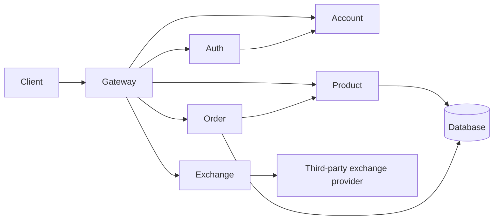

# Project

## Purpose

The platform lets authenticated users browse products, create orders and
request totals in another currency. The system is composed of a gateway,
authentication and account services, plus the product, order and exchange
services.

The project follows the [2026.2 project exercise](https://insper.github.io/platform/2026.2/exercises/project/):
the group must integrate the individual services as Git submodules and deliver
an available, working application.

## Architecture

The gateway is the only public entry point. Authentication is performed before
protected requests reach the business services. Product and order data are
persisted in the database; the order service reads product prices when an order
is created and calls Exchange when a non-USD total is requested.

## Required capabilities

| Service | Responsibility |
| --- | --- |
| Gateway | Route external requests to internal services |
| Auth | Login, issue tokens and validate tokens |
| Account | Register users and manage account data |
| Product | Create, list, retrieve and delete products |
| Order | Create and list a user's orders; retrieve an order with currency conversion |
| Exchange | Obtain and expose currency rates through a third-party provider |

The [individual exercises](https://insper.github.io/platform/2026.2/exercises/)
are the authoritative source for the required Product, Order and Exchange
endpoint shapes.

## Project workstreams

The project also includes [AWS](../infrastructure/aws.md),
[EKS](../infrastructure/eks.md), [CI/CD](../development/cicd.md),
[load testing](../operations/load-testing.md), [bottleneck analysis](../operations/bottlenecks.md),
[cost/PaaS/SLA analysis](../infrastructure/costs.md),
[observability](../operations/observability.md) and
[delivery evidence](delivery.md). These are part of the system deliverable,
not optional operational extras.

## Delivery checklist

- [ ] Each service has a README covering setup, configuration and API usage.
- [ ] Authentication and authorization are enforced for protected endpoints.
- [ ] Services communicate through documented contracts, not shared internal code.
- [ ] Health checks, structured logs and useful error responses are available.
- [ ] The complete stack runs locally with containers.
- [ ] CI builds, tests and publishes the documentation.
- [ ] The deployed system is tested with representative user flows.
- [ ] Bottlenecks, load-test results, AWS/EKS setup, CI/CD and cost/SLA analysis
      are recorded in the project delivery.
- [ ] AI assistance is disclosed per the course requirements.
