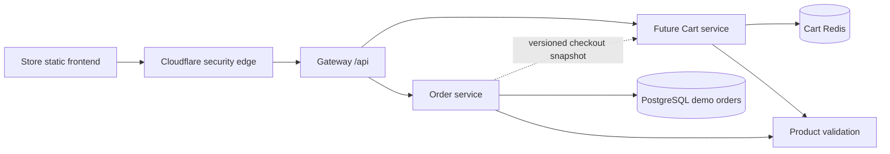

# Cart service and Redis

## Decision and implementation status

The owner selected a **dedicated Cart service backed by Redis**. A cart expires
**seven days (604800 seconds) after its last successful change**. Reading or
polling a cart never renews its TTL. These are approved architecture decisions;
there is no Cart source repository, API implementation or Redis client dependency
in this checkout yet. The current Store cart still uses browser storage.

Redis supports fast cart updates and expiring state. Cart data is temporary
application state, not a cache that can be rebuilt from PostgreSQL. The distinction
matters when choosing memory, eviction and recovery policies. The Redis
[shopping-cart guide](https://redis.io/tutorials/how-to-build-a-shopping-cart-app-using-nodejs-and-redis/)
describes hash-based carts; [EXPIRE](https://redis.io/docs/latest/commands/expire/)
provides key expiration.

## Ownership and data flow

Cart owns cart items, revision, expiry and guest-to-account merge rules. Gateway
routes requests and maintains the browser authentication/CSRF boundary. Cart
also verifies ownership at its service boundary; it must not trust a supplied
user ID or an unsigned public header. Order owns persisted demo orders and final
prices. Product owns the catalog. Browsers never connect directly to Redis.

Preserve guest carts for public browsing and authenticated carts for account
users. An opaque, unpredictable guest capability belongs in a host-only,
HttpOnly, Secure, SameSite cookie under the API path, not in a URL. Its lifetime
must be aligned with cart changes and TTL. Authenticate account ownership from
the validated principal. Logout/session changes must clear private client query
state and prevent another account inheriting the previous cart.

## Proposed API and storage contract

The following contract is a proposal for future implementation, not live routes:

| Route                                | Behavior                                                                                                                      |
| ------------------------------------ | ----------------------------------------------------------------------------------------------------------------------------- |
| `GET /api/cart`                      | Return the caller's cart, revision/ETag and UTC expiry; missing or expired state returns an empty cart without extending TTL. |
| `PUT /api/cart/items/{productId}`    | Set an absolute positive quantity; validate input/product and update revision plus TTL atomically.                            |
| `DELETE /api/cart/items/{productId}` | Remove one item with a revision precondition.                                                                                 |
| `DELETE /api/cart`                   | Clear the caller's cart explicitly.                                                                                           |
| `POST /api/cart/merge`               | Merge an owned guest cart at login, with a deduplication key and revision protection.                                         |

Use bounded product IDs and integer quantities, plus cart revision/schema version
and UTC timestamps. Product price, stock and totals are not authoritative cart
fields. Product names and thumbnails can be displayed from the catalog; prices
must be revalidated at checkout. Proposed line-item and quantity limits must be
agreed in the API implementation before release.

Use native Redis hashes/transactions through the selected framework client.
Mutations must atomically change data, increment revision and apply expiry; a
crash between update and expiry must not create immortal carts. Prefer
compare-and-set/revision checks over unbounded retries or custom locking.
Conditional write conflicts return 412 and trigger refetch/reconciliation.
Redis Cluster transactions must keep all affected keys in the same hash slot;
do not claim an atomic cross-user or cross-slot merge. A repeated merge must not
add quantities twice, and the guest source must survive until acknowledgement.

Use opaque identifiers in keys and enforce ownership independently of key
unpredictability. A Redis outage returns an explicit unavailable state, not a
successful empty cart. Do not silently overwrite a newer server cart with the
legacy browser copy or fall back to an independent browser source of truth.

## Checkout and concurrency

Order should consume a versioned Cart snapshot through a future accepted
contract and recalculate all prices through Product. The existing Order API
accepts item IDs/quantities; do not silently change it or claim cart checkout is
implemented. Add durable Order idempotency before retrying uncertain creation.

After an order is persisted, clear only the submitted cart revision/items.
Concurrent additions must survive. Failure to clear Redis must not turn a
persisted order into a reported failed order. A future `order.created.v1`
consumer can retry cleanup using an idempotent, revision-aware Cart operation;
Kafka and Redis do not form a transaction with the Order database.

## Capacity, recovery and acceptance

Isolate cart state from disposable product/rate caches. A separate Redis logical
database does not isolate memory eviction policies; prefer a dedicated instance
or managed database with independent resource/policy controls. A starting
recommendation is `noeviction` with memory headroom and alerts: reject writes
visibly rather than evict active carts under pressure. Expiration still removes
stale carts. See Redis [eviction policies](https://redis.io/docs/latest/develop/reference/eviction/).

Seven-day TTL is not a seven-day durability promise. Choose managed replication,
failover, AOF/snapshot policy and acceptable data loss at deployment. AOF is not
a backup, and the current disposable MicroK8s Redis is not production cart
storage. Consult Redis [persistence](https://redis.io/docs/latest/management/persistence/).

Before rollout: approve the Cart repository/framework Redis dependency; implement
Gateway routes and guest/auth/CSRF enforcement; test TTL without waiting seven
days using a controlled clock/test configuration; verify reads do not refresh
TTL; test cross-account isolation, concurrent edits, duplicate merges, expiry,
outage behavior, checkout retry and revision-safe cleanup. Migrate the legacy
`ms52-cart-v1` browser cart once through an explicit idempotent import, then
remove it only after server acknowledgement. Keep the online-only PWA and the
mock-store/no-real-transactions message.
